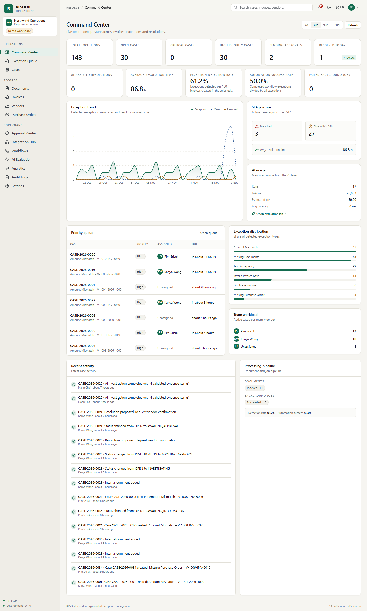
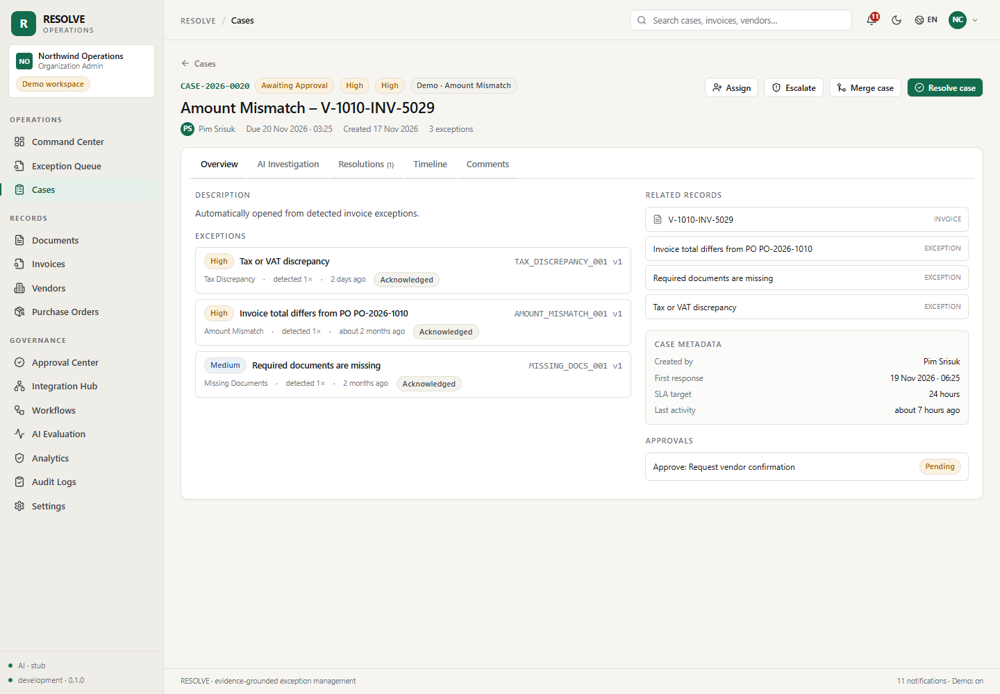
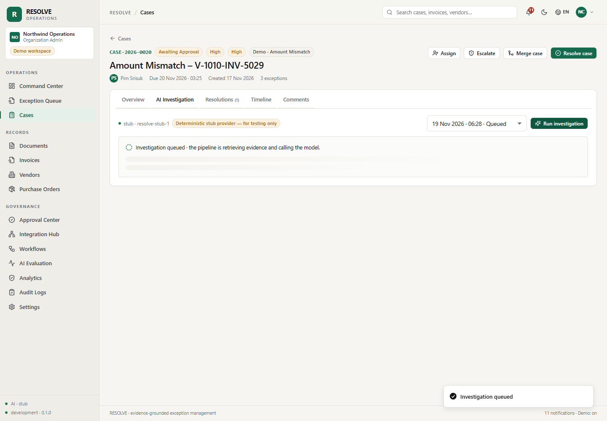
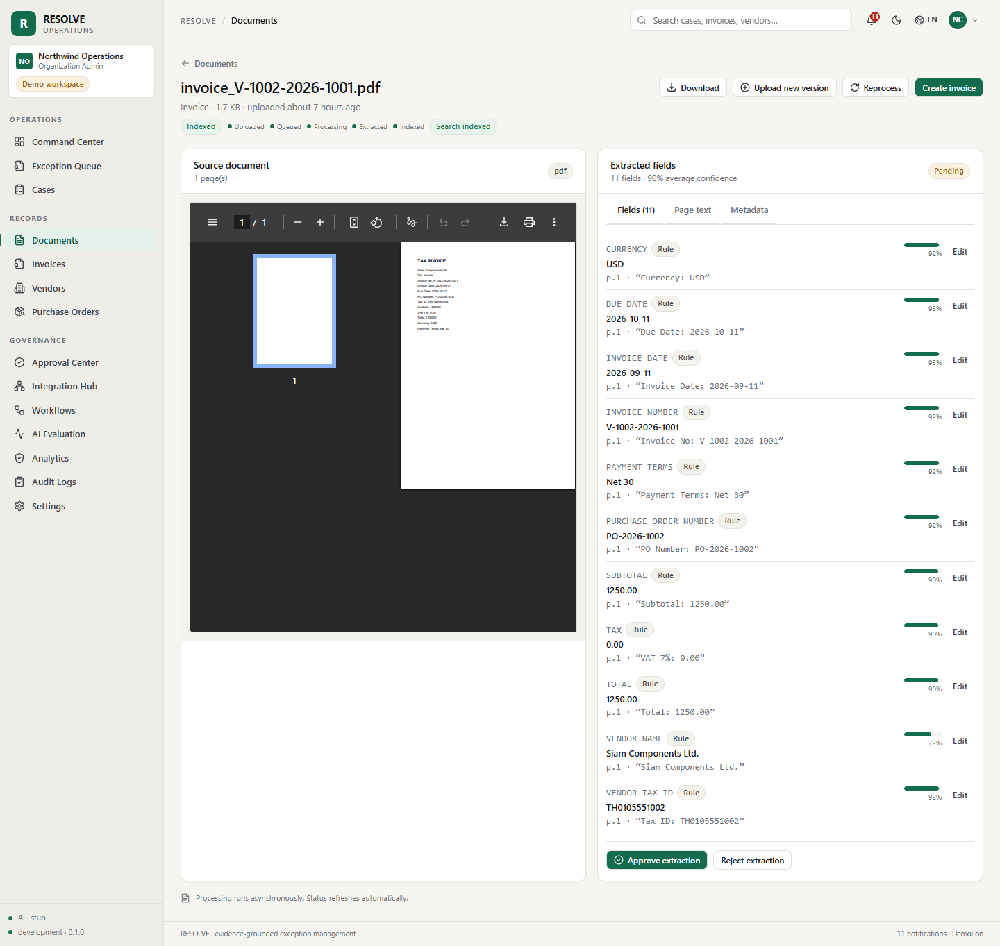
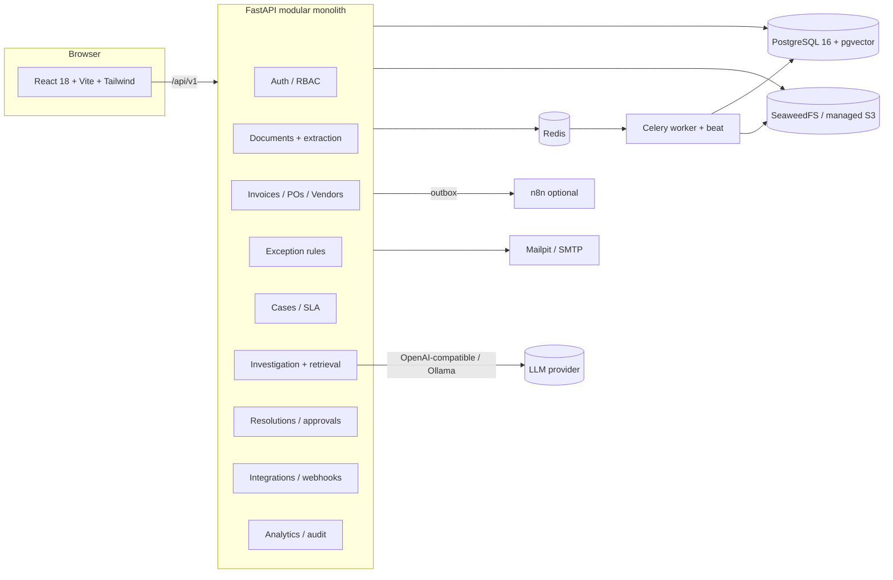

# RESOLVE

**Intelligent exception management, AI investigation and workflow resolution.**

RESOLVE is a full-stack operations platform for invoice exceptions. It detects discrepancies with
deterministic rules, investigates them with evidence-grounded AI, and resolves them through
human-in-the-loop approvals with a complete audit trail. Financial calculations, permissions,
state transitions and execution safety are always handled by deterministic code — never by an LLM.



## Why this exists

When an invoice fails a control (duplicate, amount mismatch, missing PO, bad VAT, failed OCR), the
work is rarely the detection. The work is the investigation: finding the right documents, comparing
records across systems, deciding who must approve, proving what happened, and recording evidence.
RESOLVE models that work explicitly.

- **Deterministic first.** Decimal arithmetic, tolerance rules, duplicate fingerprints and state
  machines decide. AI explains and recommends.
- **Evidence, not prose.** Every AI claim is validated against real organization-scoped documents,
  pages, chunks, invoices and records. Fabricated IDs or quotes are rejected and surfaced.
- **Human control.** High-risk, financial and external actions require an approval that cannot come
  from the requester. Every execution is idempotent and audited.
- **Works without external SaaS.** Documents are parsed locally; email has a file sink; the task
  runner falls back to local threads when Redis/Celery is absent; n8n is optional and failures are
  shown as failures.

## Feature overview

| Area | What is implemented |
| --- | --- |
| Auth & tenancy | JWT access tokens, rotating refresh tokens in httpOnly cookies with reuse detection, Argon2id passwords, password reset, sessions, six roles, 47 permissions, organization isolation enforced in every service |
| Documents | Upload validation (MIME/magic/size), SHA-256 duplicate detection, local or S3-compatible storage (SeaweedFS in Compose, managed S3 in production), real PDF/DOCX/XLSX/CSV/TXT extraction, Tesseract OCR with graceful "OCR unavailable" failure, page-anchored fields, confidence, corrections, approval/rejection, versioning, chunking and embeddings |
| Document intelligence | Deterministic invoice parser (labels, dates, amounts, tax IDs, PO numbers), optional LLM fallback with quote validation, arithmetic validation, human review |
| Exceptions | 10 versioned rules: duplicate invoice, amount mismatch, vendor mismatch, missing PO, missing documents, tax discrepancy, invalid date, duplicate vendor, extraction anomaly, integration failure; stable fingerprints, dedupe counters, automatic case grouping |
| Cases | Case numbers, SLA due dates, assignment history, priority/severity, comments (internal/external), timeline, escalation, merge, resolve/close/reopen with validated transitions |
| AI investigation | Structured-output pipeline with bounded retries, timeouts, token/cost/latency tracking, prompt versioning, prompt-injection defences, retrieval over contracts/policies/SOPs, similar-case retrieval, per-evidence validation, explicit "insufficient evidence" behaviour |
| Knowledge/RAG | Portable chunk embeddings, exact cosine + keyword hybrid search, permission/status filtering, optional pgvector HNSW fast path, citation checks |
| Resolutions & approvals | Allow-listed action registry with typed parameters, deterministic policy engine, approval expiry, self-approval blocking, approval & execute, idempotency keys, execution attempt history, failure persistence |
| Automation | Integration registry (REST, webhook, n8n, CSV, Excel, S3, email), encrypted credentials, connection tests, signed inbound webhooks with idempotency, outbox fan-out, seven importable n8n templates, background job monitoring |
| Notifications | In-app notifications, preferences, email via sink/Mailpit/SMTP, approval/case/integration events |
| Analytics | Command center KPIs, trends, distributions, SLA posture, workload, AI usage/cost, processing pipeline — all from real SQL |
| AI evaluation | Datasets, real runs, per-sample results, accuracy/precision/recall/F1, root-cause, evidence, citation, recommendation and groundedness metrics, deterministic-stub labelling |
| Audit | Append-only audit log with actor, request ID, before/after snapshots, filters and CSV export |
| Frontend | 20+ routes, responsive enterprise UI, light/dark themes, English/Thai, typed API contracts, loading/error/empty states, real actions everywhere |

## Screenshots

| Exception queue | Case workspace |
| --- | --- |
|  |  |

| AI investigation | Document review |
| --- | --- |
|  |  |

More screenshots live in [`docs/screenshots`](docs/screenshots): invoices, vendors, purchase orders,
approvals, integrations, workflows, AI evaluation, analytics, audit, settings and dark mode.

## Verification status

Independently verified in this repository (see
[`docs/FINAL_VERIFICATION_REPORT.md`](docs/FINAL_VERIFICATION_REPORT.md) and
[`docs/ONE_RUN_SETUP_REPORT.md`](docs/ONE_RUN_SETUP_REPORT.md)):

- **134 backend tests pass on PostgreSQL 18.6**; 133 pass on SQLite (one PostgreSQL-only test skips).
- Native Windows deployment is running as auto-start services: PostgreSQL 18.6 + **pgvector 0.8.1**
  (HNSW `Index Scan` verified), Redis/Memurai, Celery worker/beat, Mailpit, **Ollama** (Qwen2.5 7B +
  BGE-M3), FastAPI and nginx.
- **Docker Compose is verified after the Windows reboot**: PostgreSQL 16 + pgvector, Redis, SeaweedFS
  S3, API, worker, beat, nginx, Mailpit, n8n and optional Prometheus/Grafana all start healthy. The
  Compose demo seed wrote 42 objects to SeaweedFS (65 after workflow/OCR verification uploads); upload,
  processing and download work; backup and
  restore were verified into a new database and bucket with all 42 SHA-256 hashes matching.
- **Compose E2E: 10/10 Playwright tests pass against `https://127.0.0.1:8180`**, including a real
  Ollama investigation. Recreating the API container no longer causes nginx 502s (DNS re-resolution
  is configured).
- A live 27-step workflow (upload → OCR/extraction → exceptions → **real local AI investigation** →
  approval → SMTP execution → audit → analytics) was verified through the LAN URL.
- Real OCR (Tesseract 5.4, English + Thai) verified on PNG, JPG and scanned PDF; PDF, DOCX, XLSX and
  CSV extraction verified.
- Frontend: typecheck, lint, Vitest, production build and **10 Playwright tests** pass against the
  nginx/LAN deployment, including all routes, pagination, permissions, error/retry, Thai locale and
  dark theme.
- Backup/restore verified into an isolated database, including vector rows.

**Not verified here:** a physical macOS client (LAN access was tested from Windows to the LAN IP;
macOS commands are documented), n8n workflow execution with real credentials, and Prometheus/Grafana
dashboards with production traffic (the containers and health endpoints were verified). External AI
provider credentials were not available. Managed S3/R2/B2 was not tested with real cloud credentials;
Compose uses the verified SeaweedFS S3 path and production guidance still recommends managed storage.

## One-run Windows deployment

The primary deployment is **Docker Compose**; the native Windows services remain as a localhost
rollback. Only nginx is exposed to the LAN.

```powershell
cd "E:\Code\AI project"
.\scripts\start-resolve.ps1      # prefers Docker, waits for health, prints URLs
.\scripts\status-resolve.ps1
.\scripts\health-check.ps1 -Deep
.\scripts\stop-resolve.ps1       # preserves all volumes/data
.\scripts\restart-resolve.ps1
.\scripts\backup-resolve.ps1
```

| Purpose | URL |
| --- | --- |
| Windows UI | `https://localhost:8180` |
| macOS/LAN UI | `https://192.168.1.107:8180` |
| LAN health | `https://192.168.1.107:8180/health` |
| Mailpit (host only) | `http://127.0.0.1:8125` |
| Native rollback (host only) | `http://127.0.0.1:8090` |

Only TCP 8180 is allowed inbound (Private profile, LocalSubnet). PostgreSQL, Redis, API, SeaweedFS,
Ollama, n8n, monitoring and Mailpit are loopback-only. Docker deployment, LAN, AI, backup and
production guidance:
[`docs/FINAL_DEPLOYMENT_REPORT.md`](docs/FINAL_DEPLOYMENT_REPORT.md),
[`docs/DOCKER_DEPLOYMENT.md`](docs/DOCKER_DEPLOYMENT.md),
[`docs/AI_PROVIDER_SETUP.md`](docs/AI_PROVIDER_SETUP.md),
[`docs/LAN_ACCESS_GUIDE.md`](docs/LAN_ACCESS_GUIDE.md),
[`docs/PRODUCTION_READINESS.md`](docs/PRODUCTION_READINESS.md).

## Architecture



The API is a **modular monolith**: each domain owns its models, schemas, service and router. Cross-cutting
services (storage, audit, events, notifications, jobs) are injected explicitly. Celery is used in
Compose; without a broker, jobs run in a bounded local executor and still persist real status.

See [architecture](docs/ARCHITECTURE.md), [database](docs/database/README.md), [API](docs/api/README.md),
[security](docs/security/README.md) and [deployment](docs/deployment/README.md).

## Tech stack

- **Backend:** Python 3.12+, FastAPI, Pydantic v2, SQLAlchemy 2, Alembic, PostgreSQL 16 + pgvector,
  Redis, Celery, PyMuPDF, python-docx, openpyxl, Pillow, pytesseract, reportlab (synthetic PDFs),
  HTTPX, Pytest, Ruff
- **AI:** provider abstraction for OpenAI-compatible APIs and Ollama, structured JSON validation,
  retries/timeouts, usage and cost accounting; deterministic stub provider only for tests
- **Frontend:** React 18, TypeScript, Vite, Tailwind CSS v4, Radix primitives, TanStack Query,
  Recharts, Lucide, React Router
- **Infrastructure:** Docker Compose (API, web, PostgreSQL, Redis, worker, beat, SeaweedFS S3, n8n,
  Mailpit, optional Prometheus/Grafana), GitHub Actions CI

## Quick start

### Option A — Docker Compose (alternative full stack)

Requirements: Docker Desktop with Compose v2. This path was verified on this host after the required
WSL2/Hyper-V reboot; the native deployment above remains the other verified runtime.

```bash
cp .env.example .env
# edit SECRET_KEY and credentials; set AI_PROVIDER/AI_* for your endpoint
docker compose up --build -d
```

Host ports are isolated from the native stack:

- Web: <https://localhost:8180> (the only port bound to all interfaces)
- API: <http://127.0.0.1:8100> (docs at `/docs`)
- Mailpit: <http://127.0.0.1:8125>
- SeaweedFS S3: `127.0.0.1:9100`; master UI: <http://127.0.0.1:9101>
- n8n: <http://127.0.0.1:5679>
- PostgreSQL: `127.0.0.1:5433`, Redis: `127.0.0.1:6380`
- Prometheus/Grafana (monitoring profile): `127.0.0.1:9190` / `127.0.0.1:3101`
- Demo login after seeding: `admin@example.com` / `the password in var/secrets/demo-credentials.txt`

The API container waits for PostgreSQL, applies Alembic migrations, and seeds only when
`SEED_DEMO=true` and the workspace is empty. Set `AI_PROVIDER` and the matching credentials (or
Ollama via `host.docker.internal`) to enable AI; without them the product still runs and clearly
reports **AI unavailable**. To seed the Compose workspace manually:

```bash
docker compose exec api python -m app.scripts.seed_demo
# or, destructively: docker compose exec api python -m app.scripts.reset_demo --yes --seed
```

Backup and restore the whole Compose stack (database + object storage):

```powershell
.\infrastructure\scripts\backup.ps1
.\infrastructure\scripts\restore.ps1 -BackupDir .\backups\compose-<stamp>
```

### Option B — Manual development

Requirements: Python 3.12+, Node 22+, and (optional but recommended) Tesseract with `eng`/`tha`
traineddata for image and scanned-PDF OCR. The API also probes the standard Windows install path.

```powershell
# Backend
python -m venv .venv
.venv\Scripts\activate
pip install -e "apps/api[dev]"
cd apps/api
# Copy .env.example, set DATABASE_URL (PostgreSQL recommended), SECRET_KEY and AI settings.
python -m alembic upgrade head
python -m app.scripts.seed_demo       # only if the workspace is empty
uvicorn app.main:app --reload --port 8000
```

```powershell
# Frontend (new terminal)
cd apps/web
npm install
npm run dev
```

`TASK_RUNNER=inline` removes the Celery/Redis requirement for a quick manual run; set
`RATE_LIMIT_ENABLED=false` only for local testing. For the verified one-command deployment use
`.\scripts\start-resolve.ps1` instead.

Open <http://localhost:5173>. The Vite dev server proxies `/api` to port 8000.

The verified native deployment's `apps/api/.env` points at PostgreSQL `resolve_live` and the local
Ollama models. For a throwaway manual run you may switch `DATABASE_URL` to SQLite and
`TASK_RUNNER=inline`, but SQLite is not accepted by production configuration validation.

### Demo users

| Email | Role |
| --- | --- |
| `admin@example.com` | Organization Admin |
| `manager@example.com` | Operations Manager |
| `investigator@example.com` | Investigator |
| `approver@example.com` | Approver |
| `viewer@example.com` | Viewer |

All rotated demo accounts use the strong password stored in
`var/secrets/demo-credentials.txt` (ignored by Git, ACL-restricted). The previously published demo password is rejected. These accounts exist only in the synthetic demo workspace; remove or re-key them before
handling real data.

## AI configuration

```bash
# OpenAI-compatible
AI_PROVIDER=openai
AI_BASE_URL=https://api.openai.com/v1
AI_API_KEY=sk-...
AI_MODEL=gpt-4o-mini
AI_EMBEDDING_PROVIDER=openai
AI_EMBEDDING_MODEL=text-embedding-3-small

# Local Ollama
AI_PROVIDER=ollama
AI_BASE_URL=http://localhost:11434
AI_MODEL=llama3.1:8b
AI_EMBEDDING_PROVIDER=ollama
AI_EMBEDDING_MODEL=nomic-embed-text
AI_EMBEDDING_DIM=768
```

Optional `AI_INPUT_COST_PER_1K` / `AI_OUTPUT_COST_PER_1K` enable cost accounting. Every AI record
stores provider, model, prompt version, tokens, latency and cost. The **deterministic stub**
(`AI_PROVIDER=stub`) exists for automated tests and is permanently labelled in the UI and metrics;
it is not a semantic model and must never be used in production.

If no provider is configured, investigation/re-evaluation endpoints return clear failures and the
UI shows *AI unavailable*; nothing is silently fabricated.

## Testing

```bash
# Backend: 134 tests (SQLite default; set RESOLVE_TEST_DATABASE_URL for PostgreSQL)
cd apps/api
pytest -q

# Backend against PostgreSQL
$env:RESOLVE_TEST_DATABASE_URL = "postgresql+psycopg://resolve@127.0.0.1:55432/resolve"
pytest -q

# Frontend unit tests
cd apps/web
npm test

# Lint and typecheck
ruff check apps/api
npm run lint
npm run typecheck

# End-to-end (defaults to Vite on :5173; set RESOLVE_WEB_URL for Compose/nginx)
cd apps/web
npx playwright test
$env:RESOLVE_WEB_URL = "https://127.0.0.1:8180"; npx playwright test

# Compose backup / restore (database + object storage)
.\infrastructure\scripts\backup.ps1
.\infrastructure\scripts\restore.ps1 -BackupDir .\backups\compose-<stamp> -Database resolve_restore
```

Coverage highlights: financial Decimal arithmetic, rule behaviour and dedupe, RBAC and cross-org
isolation, auth rotation/reuse detection, document upload/processing/review, case state machines,
AI output validation and hallucinated evidence rejection, approvals and self-approval policy,
idempotent execution, webhook signatures, honest failure handling, analytics, evaluation metrics,
and S3 path-style client/bucket-race/sync safety regressions.

## n8n

Importable workflow exports are in [`infrastructure/n8n/workflows`](infrastructure/n8n/workflows) with
setup notes. RESOLVE remains fully functional without n8n: webhook fan-out is skipped, and workflow
executions are recorded as **failed** with a clear reason rather than pretending to succeed.

## Demo mode

`python -m app.scripts.reset_demo --yes --seed` creates a labelled demo workspace with 11 vendors,
20 purchase orders, 103 invoices, real generated PDF invoices/contracts, 140+ exceptions across 30
cases, approvals, integrations and workflow history. Reset is destructive and refuses to run when
`ENV=production`. All seeded records are marked as demo where the schema allows it.

## Project layout

```text
apps/api        FastAPI application, migrations, tests, scripts
apps/web        React/TypeScript application, unit and E2E tests
packages        shared OpenAPI types, integration SDK, evaluation CLI
infrastructure  Docker, n8n templates, monitoring, backup scripts
datasets        demo import file, evaluation dataset and schema
docs            architecture, database, API, security, deployment, testing, decisions
```

## Known limitations & honest notes

- **pgvector** is compiled and verified on the native PostgreSQL 18.6 service (`vector(1024)`,
  HNSW geometry, real `Index Scan`, `hybrid+pgvector`). Compose uses the official
  `pgvector/pgvector:pg16` image.
- **OCR** requires the Tesseract binary. Real OCR was verified here on PNG, JPG and scanned PDF;
  when Tesseract is missing, image-only documents fail with an explicit `ocr_unavailable` error and
  are flagged for review instead of inventing text. Text-layer PDFs work without OCR.
- **n8n templates** are exports, not pre-credentialed automations. SMTP credentials and environment
  variables must be configured in n8n.
- **Docker/SeaweedFS:** Compose is verified after the reboot. MinIO's images were retired upstream,
  so Compose uses SeaweedFS with an authenticated S3 gateway, path-style addressing and a raised
  volume cap. The gateway is loopback-only; only the web port is reachable from the LAN. Production
  should still use managed S3/R2/B2 rather than a single-node development object store.
- **S3 backup tooling:** the AWS CLI v2 streaming-checksum uploads are rejected by this SeaweedFS
  build, so `app.scripts.s3_sync` (boto3, path style, retries) is used for backup/restore. Any
  S3-compatible provider works with the same script.
- **LLM evaluations** executed with the stub provider measure the harness, not model quality; every
  such run is labelled `deterministic_stub`. The live deployment uses Qwen2.5 7B locally.
- **Localization depth**: English and Thai are supported across navigation, authentication, page
  titles, core actions and dashboard metrics. Some detailed table headers and technical field labels
  fall back to English; the dictionary is structured for full coverage as the product matures.
- **Mypy** is not enforced in CI because SQLAlchemy 2 typed relationships and FastAPI dependency
  overrides produce noisy third-party errors; Ruff, TypeScript and runtime tests gate merges.

## Roadmap

- Calibrate AI confidence against labelled production data and add drift monitoring.
- Add vendor portal uploads and email ingestion (IMAP/Graph) behind the existing integration registry.
- Replace exact cosine fallback with pgvector ANN by default once PostgreSQL is the only target.
- Add OIDC/SAML SSO, SCIM provisioning and per-field document permissions.
- Add a formal rules DSL with safe expression evaluation and a visual rule builder.

## License

MIT — see [LICENSE](LICENSE).
