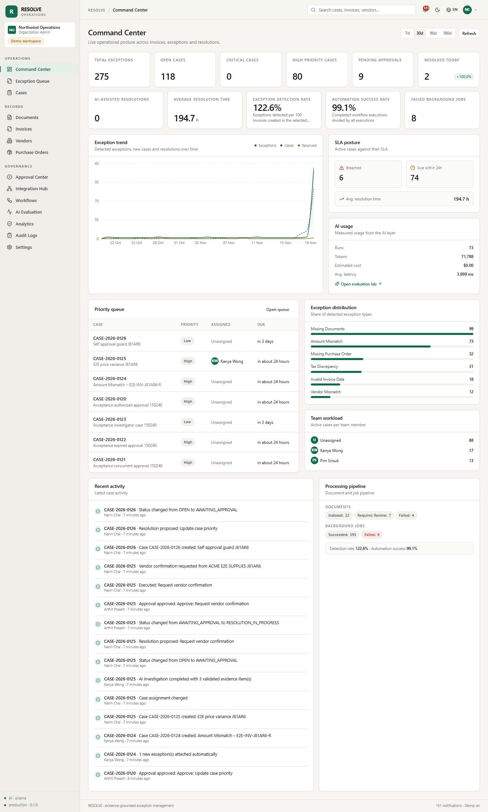
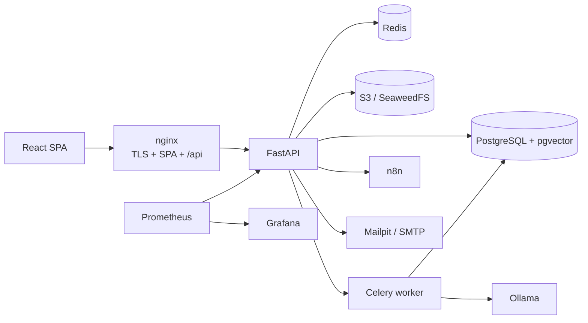

# RESOLVE

An invoice exception platform where the money logic is boring on purpose, the AI is only allowed to
explain, and a person still has to approve anything that matters.

[](https://github.com/Mindenry/resolve-invoice-ops/actions/workflows/backend.yml)
[](https://github.com/Mindenry/resolve-invoice-ops/actions/workflows/frontend.yml)
[](https://github.com/Mindenry/resolve-invoice-ops/actions/workflows/security.yml)
[](LICENSE)



The screenshots are from the demo workspace, not a mock-up.

I built this as a portfolio project, but I tried to treat it like something that would actually run in
an office: HTTPS, real backups, monitoring, and a demo workspace that behaves like a real one.

Most of the work in accounts payable is not spotting the bad invoice. Detection is a rule. The slow
part is everything after: finding the contract, checking the PO, figuring out what happened last time,
deciding who is allowed to approve, and proving months later why the invoice was paid or rejected.

So the project is built around that gap. Rules catch the problem. An investigation collects evidence.
A resolution has to go through an approval that the person who proposed it cannot give themselves.
And every step leaves a record.

It is a v1.0.0 portfolio/demo release. I would not point it at real invoices yet, and the section at
the bottom explains why.

## What it does

- Uploads PDFs, Word/Excel files, CSVs and scans, with size and file-type checks plus SHA-256
  duplicate detection.
- Pulls invoice fields out with a deterministic parser. OCR (Tesseract, English and Thai) handles
  scans, and the LLM is only a fallback when required fields are missing.
- Runs ten versioned exception rules: duplicates, amount and currency mismatches, vendor mismatches,
  missing POs, missing documents, VAT problems, bad dates, duplicate vendors and a couple of others.
- Keeps cases with SLA dates, assignment history, comments, a timeline and an audit trail.
- Runs an AI investigation over the case, the invoice and related documents, then checks every
  citation it produced against real records before showing it to anyone.
- Turns suggestions into proposals. A proposal can be approved, rejected, or executed if the policy
  allows it, and execution is idempotent.

I also added analytics, in-app notifications, an n8n integration for escalations and daily summaries,
and provisioned Grafana dashboards. Those are useful, but they are not the reason the project exists.

## How it is put together



It is a modular monolith. I thought about splitting services and decided not to: approvals, money and
audit all benefit from one transaction boundary, and there is no scaling problem here that justifies
the extra failure modes. Each domain still has its own models, schemas, service and router, so it
would not be painful to extract later.

Domain events go into an outbox in the same transaction as the business change. Celery beat publishes
them later. If n8n is down, the event retries and shows up as failed; the invoice or approval that
caused it is already committed and unaffected.

The nine diagrams I used while building it (backend, ERD, AI pipeline, document pipeline, approval
state machine, auth, deployment, backup) are in
[portfolio/ARCHITECTURE_DIAGRAMS.md](portfolio/ARCHITECTURE_DIAGRAMS.md).

## The AI part

The model runs locally through Ollama: `qwen2.5:7b-instruct` for the investigation and `bge-m3` for
embeddings. Embeddings are 1024 dimensions and stored in pgvector with an HNSW index, so retrieval is
a SQL query, not another service to operate.

Retrieval is hybrid, keyword plus cosine similarity, and similar resolved cases are included because
"we handled this before" is often the most useful context.

The part I care about is what happens after the model answers. Every citation has to resolve to a real
document, page, chunk or case in the same organization. If it does not, it is stored as invalid and
the investigation can end up as `NEEDS_REVIEW` instead of pretending it is confident. The model has no
tools and no write access. It cannot approve, execute or change a status.

If no provider is configured, the UI says AI is unavailable. Nothing gets faked.

## Approvals, and a bug I only found at the end

Approval is the part I rewrote the most.

The requester cannot decide their own request, the approver has to be the assigned one, and approving
and executing are separate permissions. Risk levels decide whether a proposal needs approval at all.

During the final test pass I ran two approvals against the same request at the same time. Both
returned 200. That is exactly the kind of bug that looks fine in a single-user demo and then shows up
in production.

The original code read the row, checked `PENDING`, changed it through the ORM and inserted a decision.
Two transactions could both pass that check. The fix was to claim the row with a conditional update:

```python
update(ApprovalRequest)
    .where(ApprovalRequest.id == approval.id, ApprovalRequest.status == PENDING)
    .values(status=new_status, decided_at=now, decided_by_id=actor.id)
```

If the update touches zero rows, the loser gets a 409 and writes nothing: no decision, no execution,
no audit entry. There is a regression test for it now, and the live check returns one 200 and one 409.

## What I tested

I tried to be honest about this instead of listing only the happy paths.

- 137 backend tests plus one skipped PostgreSQL-only test.
- 10 Playwright tests over HTTPS, including permission boundaries and an API failure with retry.
- A 26-case acceptance run covering duplicates, VAT, currency, partial invoices, low-confidence OCR,
  corrupt and oversized uploads, duplicate and forged webhooks, concurrent and expired approvals,
  self-approval, cross-tenant access and retry after a failed document.
- 16 security checks: cookies, headers, rate limiting, exposed ports, error leakage.
- A 28-step end-to-end run over HTTPS with real Ollama, real OCR and a real approval to execution.
- 24 responsive checks (desktop, tablet, mobile) with zero horizontal overflow and zero app console
  errors.

While capturing screenshots I hit another real bug: the shared Button component passed multiple
children to Radix `Slot` when `asChild` was set, which crashed the invoice detail page. That is fixed
and covered by the screenshots and the E2E suite.

What I could not test: macOS/Safari (no Mac here), external SMTP (Mailpit only), a public domain and a
hardened Linux host. Those are written down in
[portfolio/KNOWN_LIMITATIONS.md](portfolio/KNOWN_LIMITATIONS.md) rather than hidden.

## Running it

You need Docker with Compose. Ollama is optional.

```bash
git clone https://github.com/Mindenry/resolve-invoice-ops.git
cd resolve
cp .env.example .env
```

Fill the blank values. Compose refuses to start until these exist: `POSTGRES_PASSWORD` (and the
matching `DATABASE_URL`), the S3 keys, `N8N_ENCRYPTION_KEY`, `N8N_WEBHOOK_SECRET`,
`N8N_OWNER_PASSWORD`, `GRAFANA_PASSWORD`, and the `RESOLVE_AUTOMATION_*` values.

Generate a secret with:

```bash
python -c "import secrets; print(secrets.token_urlsafe(48))"
```

For HTTPS on localhost, mkcert is the least annoying option:

```bash
mkcert -install
mkdir -p var/certs
mkcert -cert-file var/certs/server.pem -key-file var/certs/server-key.pem localhost 127.0.0.1
```

Then:

```bash
docker compose --profile monitoring up -d --build
```

Open `https://localhost:8180`. Set `SEED_DEMO=true` on the first run if you want the synthetic
workspace.

For development with reload and Vite:

```bash
docker compose -f docker-compose.yml -f docker-compose.dev.yml up --build
```

That serves the UI on `http://localhost:5173`.

Demo accounts are `admin@example.com` (org admin), `manager@example.com` (operations),
`investigator@example.com`, `approver@example.com` and `viewer@example.com`. Passwords live in an
ignored, restricted file created by the provisioning scripts, not in the repo.

## Stack

| Layer | Tools |
| --- | --- |
| Backend | Python 3.12, FastAPI, Pydantic v2, SQLAlchemy 2, Alembic, Celery |
| Data | PostgreSQL 16 + pgvector, Redis, SeaweedFS (S3-compatible) |
| AI | Ollama, qwen2.5, bge-m3, or any OpenAI-compatible endpoint |
| Documents | PyMuPDF, python-docx, openpyxl, Tesseract |
| Frontend | React 19, TypeScript, Vite, TanStack Query, Recharts |
| Ops | Docker Compose, nginx, Prometheus, Alertmanager, Grafana, Mailpit, n8n |

## Where things live

```text
apps/api            FastAPI app, domain modules, workers, migrations, tests
apps/web            React app, design system, Playwright and Vitest
infrastructure      nginx, monitoring config, n8n workflows
docs                runbooks and the closure report
portfolio           the longer write-up, diagrams, demo script, screenshots
scripts             provisioning and verification helpers
```

If you only read one other document, make it
[portfolio/PROJECT_OVERVIEW.md](portfolio/PROJECT_OVERVIEW.md). The short version is also in
[portfolio/TECHNICAL_ARCHITECTURE.md](portfolio/TECHNICAL_ARCHITECTURE.md) and the demo walkthrough is
in [portfolio/DEMO_SCRIPT.md](portfolio/DEMO_SCRIPT.md). If you want to try it yourself, the checklist
in [docs/MANUAL_TEST_GUIDE.md](docs/MANUAL_TEST_GUIDE.md) includes the synthetic invoice files.

## Rough edges

The demo workspace still has synthetic data and accounts. Delete or re-key them before using this with
real invoices.

It runs on a single node. PostgreSQL, Redis and object storage are not replicated. Docker Desktop on
Windows is not a production runtime, and the rate limiter shares one bucket per published port because
of how Docker rewrites client addresses on this setup.

There is no malware scanning on uploads, no SSO, and no independent penetration test.

None of that is hidden in the code; it is documented in
[portfolio/KNOWN_LIMITATIONS.md](portfolio/KNOWN_LIMITATIONS.md), along with what I would do before
letting it near real money.

## License

MIT. See [LICENSE](LICENSE).
