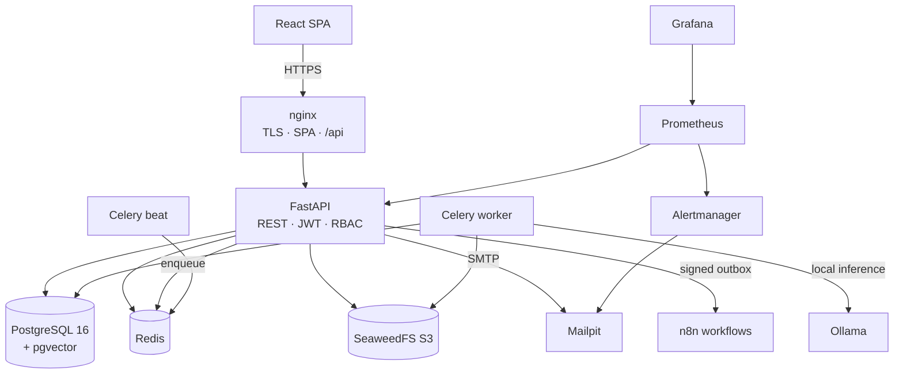
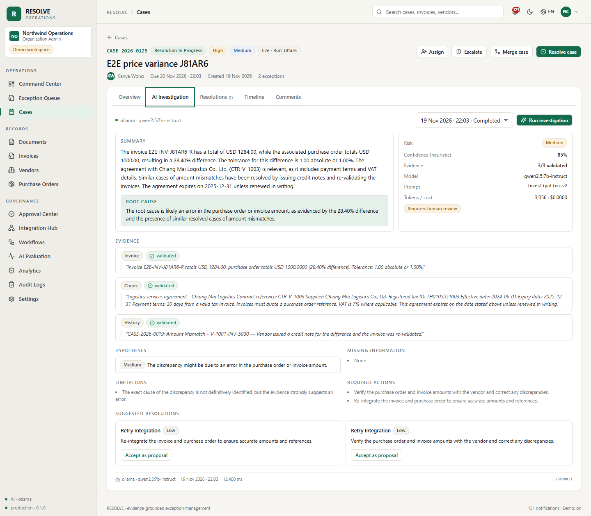
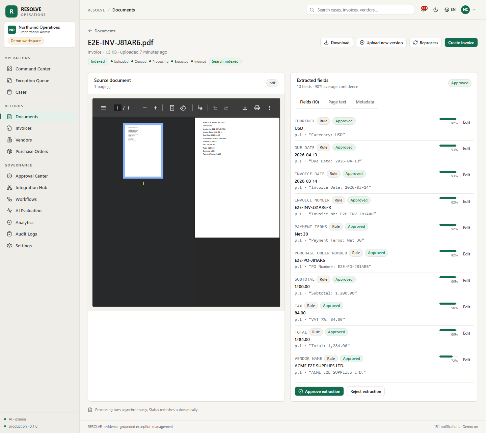
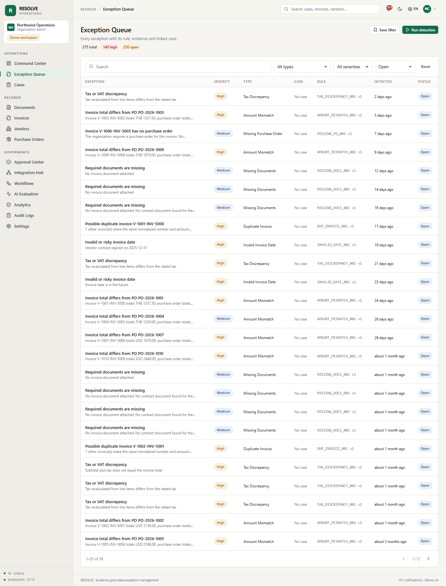
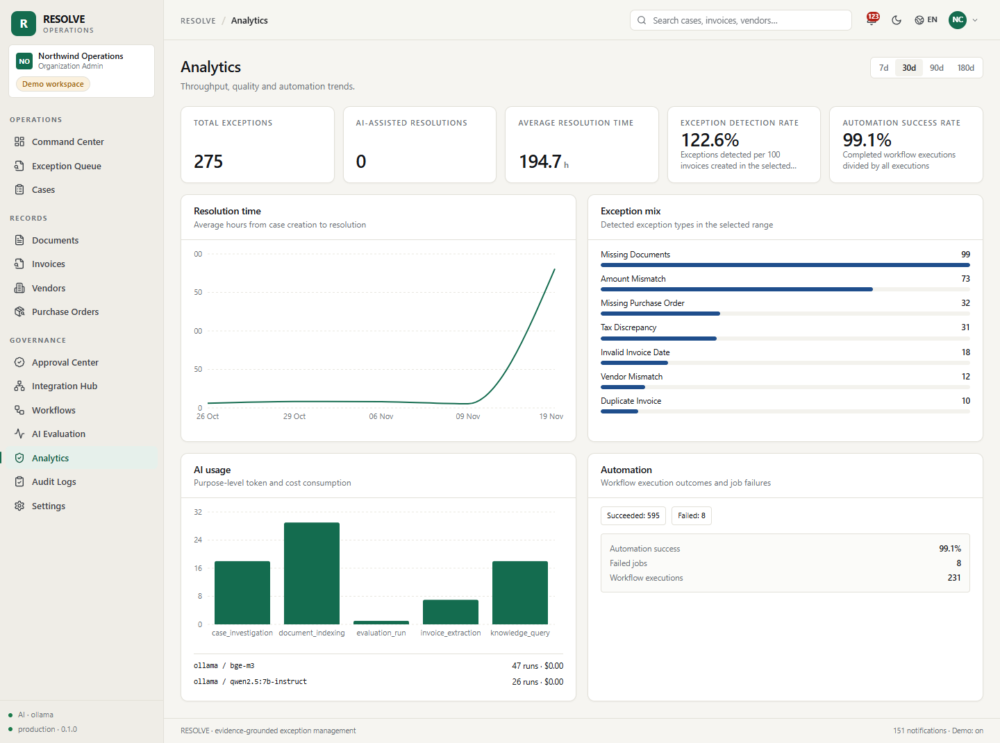

<div align="center">

# RESOLVE

**Evidence-grounded invoice exception management — deterministic controls, local AI investigation, human approval.**

[](https://github.com/Mindenry/resolve/actions/workflows/backend.yml)
[](https://github.com/Mindenry/resolve/actions/workflows/frontend.yml)
[](https://github.com/Mindenry/resolve/actions/workflows/infrastructure.yml)
[](https://github.com/Mindenry/resolve/actions/workflows/security.yml)
[](https://github.com/Mindenry/resolve/tags)
[](LICENSE)

</div>


RESOLVE is a full-stack platform for accounts-payable exceptions. It detects invoice discrepancies
with deterministic, versioned rules, investigates them with evidence-grounded local AI, and resolves
them through approvals that the requester cannot bypass.

The design principle is simple: **code decides money and state; AI explains and recommends; a human
approves.** Every AI citation must resolve to a real record in the same organization, and every
financial action is idempotent and audited.

---

## Why this exists

Detecting a duplicate invoice or a VAT error is the easy part. The expensive work is the
investigation: finding the contract, comparing the PO, checking prior cases, deciding who may
approve, proving the decision later, and making sure the invoice is never paid twice.

| Principle | Implementation |
| --- | --- |
| **Deterministic first** | `Decimal` / `NUMERIC(18,4)` money math, tolerance rules, duplicate fingerprints, validated state machines |
| **Evidence, not prose** | Every AI claim is re-validated against organization-scoped documents, pages, chunks, invoices and cases; invalid citations are flagged |
| **Human control** | Separate approval and execution permissions, assigned approvers, self-approval blocked, atomic decisions under concurrency |
| **Operable** | HTTPS, structured logs, Prometheus metrics, alerting, provisioned dashboards and verified backup/restore |

---

## At a glance

| Layer | Stack |
| --- | --- |
| Backend | Python 3.12, FastAPI, Pydantic v2, SQLAlchemy 2, Alembic, Celery |
| Data | PostgreSQL 16 + pgvector 0.8 (HNSW), Redis 7, SeaweedFS S3 |
| AI | Ollama (`qwen2.5:7b-instruct`, `bge-m3`, 1024-dim), pluggable OpenAI-compatible provider |
| Documents | PyMuPDF, python-docx, openpyxl, Tesseract OCR (English + Thai) |
| Frontend | React 19, TypeScript, Vite, TanStack Query, Recharts |
| Automation | n8n 2.48 workflows with HMAC-signed events and Redis-backed idempotency |
| Operations | Docker Compose, nginx TLS, Prometheus, Alertmanager, Grafana, Mailpit |
| Quality | 137 backend tests, 10 Playwright E2E, 26-case acceptance suite, 16 security checks |

---

## Architecture



The backend is a modular monolith: each domain owns its models, schemas, services and router, while
storage, audit, events, notifications and jobs are injected explicitly. Domain events are written in
the same transaction as the business change (transactional outbox), so an integration failure can
never roll back a financial decision.

The full set of nine diagrams — backend internals, ERD, AI pipeline, document pipeline, approval
state machine, auth flow, deployment and backup — lives in
[`portfolio/ARCHITECTURE_DIAGRAMS.md`](portfolio/ARCHITECTURE_DIAGRAMS.md).

---

## What it does

- **Ingest** PDF, DOCX, XLSX, CSV, TXT and scanned images with MIME/magic/size validation, SHA-256
  duplicate detection and versioning.
- **Extract** invoice fields with a deterministic parser; OCR fallback for scans; the LLM is used only
  when required fields are missing and must quote the source text.
- **Detect** ten versioned exception rules: duplicates, amount/currency mismatch, vendor mismatch,
  missing PO, missing documents, tax discrepancy, invalid dates, duplicate vendors, extraction
  anomalies and integration failures.
- **Investigate** with hybrid retrieval (keyword + cosine over pgvector) and similar-case memory.
  Citations are validated; insufficient evidence yields `NEEDS_REVIEW`, not invented confidence.
- **Resolve** through an allow-listed action registry with risk levels, approval expiry and an
  execution record per attempt.
- **Prove** every action with an append-only audit trail, case timeline, analytics from real SQL and
  exported webhook/workflow history.

### Screenshots

| AI investigation | Document review |
| --- | --- |
|  |  |

| Exception queue | Business analytics |
| --- | --- |
|  |  |

Screenshots are captured from the running system with synthetic demo data. More in
[`portfolio/screenshots`](portfolio/screenshots).

---

## Quality gates

| Gate | Result |
| --- | --- |
| Backend (pytest) | 137 passed, 1 skipped |
| Frontend | typecheck, 0 lint errors, 6/6 unit tests, production build |
| Browser E2E | 10/10 over HTTPS |
| End-to-end workflow | 28 steps: vendor → PO → upload → OCR → exceptions → case → AI → approval → execution → audit |
| Acceptance (roles + financial edge cases) | 26/26 |
| Security | 16/16 |
| n8n contracts | 9/9 |
| Responsive / console | 24 route/viewport checks, 0 overflow, 0 app console errors |

Two real defects were found by the acceptance process and fixed: a double-approval race under
concurrency (now an atomic conditional claim) and a shared Button that broke `asChild` rendering.
Both have regression coverage. Details: [`portfolio/TESTING_AND_QUALITY.md`](portfolio/TESTING_AND_QUALITY.md).

---

## Getting started

### Prerequisites

- Docker Desktop / Docker Engine with Compose v2
- Optional: [Ollama](https://ollama.com) with `qwen2.5:7b-instruct` and `bge-m3` for local AI
- Optional: `mkcert` for trusted local HTTPS

### Run with Docker Compose

```bash
git clone https://github.com/Mindenry/resolve.git
cd resolve
cp .env.example .env
```

Fill the blank secrets in `.env`. Compose refuses to start until these are set:

`POSTGRES_PASSWORD` (and the matching `DATABASE_URL`), `S3_ACCESS_KEY`, `S3_SECRET_KEY`,
`N8N_ENCRYPTION_KEY`, `N8N_WEBHOOK_SECRET`, `N8N_OWNER_PASSWORD`, `GRAFANA_PASSWORD`,
`RESOLVE_AUTOMATION_EMAIL`, `RESOLVE_AUTOMATION_PASSWORD`, `RESOLVE_AUTOMATION_ORG_ID` and
`RESOLVE_ORGANIZATION_SLUG`.

Any long random value is fine for local use:

```bash
python -c "import secrets; print(secrets.token_urlsafe(48))"
```

Create a local certificate so nginx can serve HTTPS:

```bash
mkcert -install
mkdir -p var/certs
mkcert -cert-file var/certs/server.pem -key-file var/certs/server-key.pem localhost 127.0.0.1
```

Start the stack (the monitoring profile is optional):

```bash
docker compose --profile monitoring up -d --build
```

Open **https://localhost:8180**. API docs are on `http://127.0.0.1:8100/docs`; supporting UIs are
bound to loopback only (Mailpit `8125`, n8n `5679`, Prometheus `9190`, Grafana `3101`).

The API waits for PostgreSQL, applies Alembic migrations and seeds demo data only when
`SEED_DEMO=true` and the workspace is empty. Set `SEED_DEMO=true` for the first start if you want the
synthetic demo workspace. Without an AI provider the product still runs and reports **AI unavailable**
instead of fabricating results.

### Development mode

```bash
docker compose -f docker-compose.yml -f docker-compose.dev.yml up --build
```

This runs FastAPI with reload and Vite on `http://localhost:5173`. Native setup instructions are in
[`docs/DOCKER_DEPLOYMENT.md`](docs/DOCKER_DEPLOYMENT.md).

### Demo accounts

| Email | Role |
| --- | --- |
| `admin@example.com` | Organization Admin |
| `manager@example.com` | Operations Manager |
| `investigator@example.com` | Investigator |
| `approver@example.com` | Approver |
| `viewer@example.com` | Viewer |

Passwords are not stored in the repository; they are written to an ignored, access-restricted file by
the seeding/provisioning scripts. The demo workspace is synthetic — remove or re-key it before real
data.

---

## Configuration

Configuration is environment-only; see [`.env.example`](.env.example) for the full list.

| Area | Variables |
| --- | --- |
| Core | `ENV`, `DEBUG`, `SECRET_KEY`, `CORS_ORIGINS`, `FRONTEND_URL` |
| Data | `DATABASE_URL`, `REDIS_URL`, `S3_*`, `STORAGE_BACKEND` |
| Security | `ACCESS_TOKEN_TTL_MINUTES`, `REFRESH_TOKEN_TTL_DAYS`, `RATE_LIMIT_*`, `MAX_UPLOAD_MB` |
| AI | `AI_PROVIDER`, `AI_BASE_URL`, `AI_MODEL`, `AI_EMBEDDING_*` |
| Documents | `OCR_*`, `PDF_RENDER_DPI`, `MAX_DECOMPRESSED_MB` |
| Automation | `N8N_BASE_URL`, `N8N_WEBHOOK_SECRET`, `RESOLVE_AUTOMATION_*` |

`AI_PROVIDER=stub` exists only for automated tests and is labelled as such in the UI and metrics.

---

## Project structure

```text
apps/
  api/            FastAPI application, domain modules, workers, migrations, tests
  web/            React SPA, design system, Playwright and Vitest suites
infrastructure/
  docker/         nginx and container entrypoints
  monitoring/     Prometheus, Alertmanager, Grafana provisioning and dashboards
  n8n/workflows/  Importable RESOLVE workflows
docs/             Runbooks, deployment, security, backup/restore, closure report
portfolio/        Project narrative, architecture, demo script, interview Q&A, screenshots
scripts/          Provisioning, verification and operational helpers
datasets/         Evaluation datasets
```

---

## Documentation

| Document | Contents |
| --- | --- |
| [`portfolio/PROJECT_OVERVIEW.md`](portfolio/PROJECT_OVERVIEW.md) | Problem, users, outcomes, verified scope |
| [`portfolio/TECHNICAL_ARCHITECTURE.md`](portfolio/TECHNICAL_ARCHITECTURE.md) | Architecture and design decisions |
| [`portfolio/DATABASE_DESIGN.md`](portfolio/DATABASE_DESIGN.md) | Schema, tenancy, money, vectors |
| [`portfolio/AI_ARCHITECTURE.md`](portfolio/AI_ARCHITECTURE.md) | Retrieval, prompting, citation validation |
| [`portfolio/SECURITY_DESIGN.md`](portfolio/SECURITY_DESIGN.md) | AuthN/AuthZ, tenancy, approvals, secrets |
| [`portfolio/TESTING_AND_QUALITY.md`](portfolio/TESTING_AND_QUALITY.md) | Test strategy and evidence |
| [`portfolio/DEMO_SCRIPT.md`](portfolio/DEMO_SCRIPT.md) | 5–10 minute walkthrough |
| [`docs/HTTPS_LAN_SETUP.md`](docs/HTTPS_LAN_SETUP.md) | TLS and client trust |
| [`docs/OPERATIONS_RUNBOOK.md`](docs/OPERATIONS_RUNBOOK.md) | Start/stop, health, recovery |
| [`docs/BACKUP_RESTORE_RUNBOOK.md`](docs/BACKUP_RESTORE_RUNBOOK.md) | Verified backup and isolated restore |
| [`docs/N8N_RESOLVE_AUTOMATION.md`](docs/N8N_RESOLVE_AUTOMATION.md) | Workflows, HMAC, idempotency |
| [`docs/OBSERVABILITY_RUNBOOK.md`](docs/OBSERVABILITY_RUNBOOK.md) | Metrics, dashboards, alerts |
| [`docs/FINAL_PROJECT_CLOSURE_REPORT.md`](docs/FINAL_PROJECT_CLOSURE_REPORT.md) | Final acceptance evidence |

---

## Security posture

- Argon2id passwords, short-lived JWTs, rotating refresh tokens with reuse detection, secure cookies.
- 47 permissions across six roles; organization scoping enforced in every service; foreign identifiers
  return 404.
- Self-approval blocked; approval and execution are separate permissions; decisions are atomic under
  concurrency.
- HMAC-signed webhooks with idempotency keys; the n8n service account is read-only.
- Upload type/size/ZIP guards, parameterized SQL, generic error envelopes, rate limiting.
- One LAN port; all management UIs and data services are loopback or Docker-internal.

Known gaps — including the absence of a physical macOS test, external SMTP, malware scanning and a
hardened Linux production host — are documented honestly in
[`portfolio/KNOWN_LIMITATIONS.md`](portfolio/KNOWN_LIMITATIONS.md).

---

## Testing

```bash
# Backend
cd apps/api && python -m pytest

# Frontend
cd apps/web && npm ci && npm run typecheck && npm run lint && npm run test -- --run && npm run build

# Browser E2E (set the deployment URL and demo password in the environment)
cd apps/web && npx playwright test
```

CI runs backend, frontend, infrastructure and security workflows on every push to `main` and on pull
requests.

---

## License

MIT — see [LICENSE](LICENSE). The repository contains synthetic demo data only.
