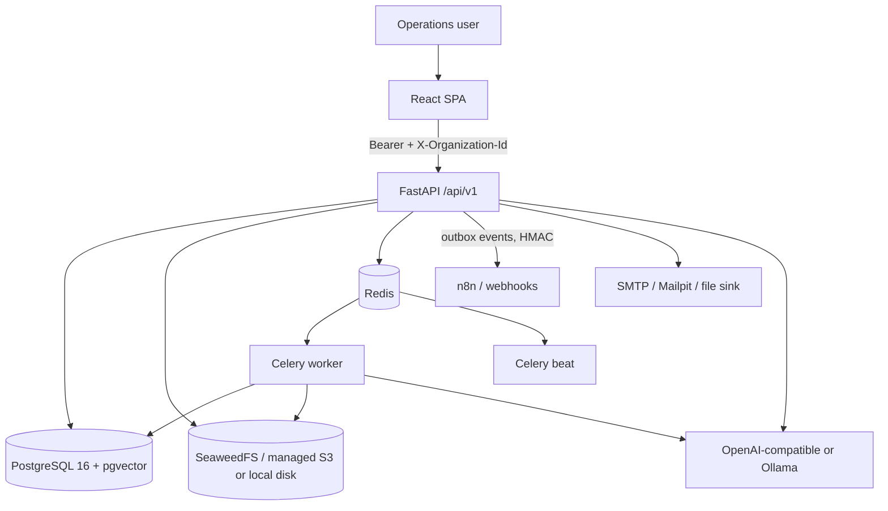
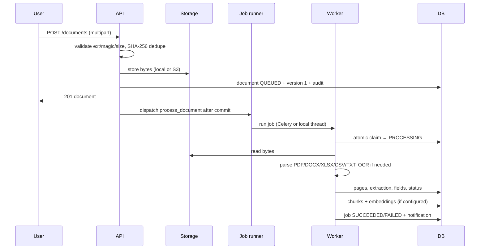
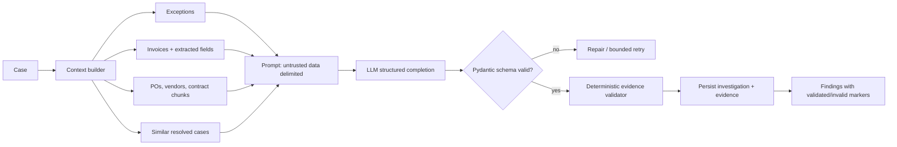

# Architecture

## 1. System context



The API is a **modular monolith**. Modules communicate through service calls and persisted domain
events, not in-process pub/sub magic. This keeps transactions understandable and lets modules be
extracted later if load demands it.

## 2. Backend module map

| Package | Responsibility | Key tables |
| --- | --- | --- |
| `modules/auth` | login, refresh rotation, registration, reset, RBAC bootstrap | users, roles, permissions, memberships, refresh_tokens |
| `modules/users` | profile, invitations, role changes | organization_memberships |
| `modules/organizations` | profile, settings, permission matrix, AI status | organizations |
| `modules/vendors` | vendor master, duplicates, merge | vendors |
| `modules/purchase_orders` | PO lifecycle, totals, candidates | purchase_orders, purchase_order_items |
| `modules/invoices` | invoice lifecycle, deterministic validation, matching | invoices, invoice_items |
| `modules/documents` | upload, storage, parsing/OCR, extraction, review, indexing | documents, pages, extractions, fields, chunks, versions |
| `modules/knowledge` | hybrid retrieval, similar cases, citation validation | document_chunks |
| `modules/exceptions` | rule engine, versioning, dedupe, case grouping | exception_rules, rule_versions, exceptions |
| `modules/cases` | case lifecycle, SLA, assignment, comments, merge | cases, links, assignments, comments, activities |
| `modules/investigation` | AI context, structured output, evidence validation | investigations, investigation_evidence |
| `modules/resolutions` | action registry, policy, execution, idempotency | resolutions, resolution_executions |
| `modules/approvals` | approval requests/decisions, expiry | approval_requests, approval_decisions |
| `modules/integrations` | registry, credentials, webhooks, workflows, jobs | integrations, credentials, webhook_events, workflow_executions |
| `modules/notifications` | in-app + email, preferences | notifications, notification_preferences |
| `modules/analytics` | command centre aggregates | read-only over domain tables |
| `modules/ai_evaluation` | datasets, runs, per-sample metrics | evaluation_* |
| `modules/audit` | append-only audit queries | audit_logs |
| `services/*` | storage, email, audit writer, outbox, notifications, deferred tasks | — |
| `workers/*` | Celery app, registry, dispatcher, inline runner | background_jobs |
| `ai/*` | providers, prompts, structured JSON client, usage | ai_usage_events |

Every module owns `schemas.py`, `service.py` and `router.py`. Routers only handle HTTP translation,
authentication dependencies and transaction boundaries; business rules live in services.

## 3. Request and transaction model

1. `RequestContextMiddleware` assigns request/correlation IDs, binds them to logs and a contextvar.
2. FastAPI dependency validates the access token, resolves the organization (header or token claim),
   verifies active membership and loads the role's permissions from the database on every request.
3. Services perform all queries with `org_id` from the principal. There is no global "current org"
   bypass; cross-org access returns 404/403.
4. Routers call `db.commit()` exactly once on success. Errors roll back via session close/rollback.
5. Background work is queued **after commit** using SQLAlchemy `after_commit` listeners, so workers
   never read uncommitted state.
6. Audit rows are written in the same transaction as the business change.

Error envelope:

```json
{"error": {"code": "invalid_case_transition", "message": "Cannot transition…", "details": {"allowed": ["INVESTIGATING"]}, "request_id": "…"}}
```

## 4. Document processing flow



Claims are atomic (`UPDATE … WHERE status IN (QUEUED, UPLOADED, FAILED, REQUIRES_REVIEW)`), preventing
duplicate processing when a job is delivered twice. Failures preserve the parser/OCR error and flag
the document for review.

Non-invoice documents (contracts, policies, SOPs) are chunked and indexed but are **not** parsed as
invoices.

## 5. Exception detection and grouping

```
invoice ──► validate_invoice (deterministic checks, validation_notes)
        └─► detect_for_invoice
              ├─ load enabled rules + active versions (org scoped)
              ├─ for each rule: evaluate(RuleContext) → Finding[]
              ├─ persist by stable fingerprint (unique per org)
              │    existing? → increment detection_count, refresh evidence, reopen
              └─ group by entity → open/reuse case, link entities, attach exceptions
```

Rule config lives in `exception_rule_versions`; editing creates a new immutable version and an audit
entry. Exceptions always record rule code and version, so historical decisions remain explainable.

## 6. AI investigation pipeline



Evidence validation checks:

- source type/id exists in the exact context provided to the model
- document belongs to the organization and is accessible
- page number exists and quote appears on that page (whitespace-normalised)
- chunk belongs to the document and quote appears in the chunk

Fabricated references are persisted as invalid (for transparency) but never counted as support. If
no evidence validates, the root cause is withheld and `requires_human_review` is forced true.

Prompt injection defence: documents are data; the system prompt forbids following instructions from
them; no tools are exposed; output must match a strict schema; every citation is validated
afterwards. Retrieved data is limited to the organization and permitted document statuses.

## 7. Retrieval / RAG

- Chunking is configurable (`CHUNK_SIZE`, `CHUNK_OVERLAP`), page-bounded.
- Embeddings are stored as portable JSON arrays with model and dimension metadata.
- Hybrid score = `KEYWORD_WEIGHT * keyword_coverage + VECTOR_WEIGHT * cosine`.
- Keyword-only mode is explicit when embeddings are unavailable; the API reports it.
- Retrieval filters organization, soft-delete and document status (`INDEXED`, `EXTRACTED`).
- PostgreSQL deployments get an `embedding_vec vector(384)` column and HNSW cosine index **only when
  the `vector` extension is installable**; the migration probes inside a SAVEPOINT and skips both
  otherwise. Retrieval uses `<=>` when present and falls back to exact cosine. The capability probe
  is cached and SAVEPOINT-protected so a missing extension can never abort the transaction.
- Retrieval runs are recorded as AI usage where an embedding provider is used.

## 7a. Cross-database and concurrency invariants

- JSON array filters use a dialect-aware predicate (`JSONB @>` on PostgreSQL, quoted-token match on
  SQLite) because the schema stores `JSON`, not `JSONB`.
- Case numbers are allocated under a transaction-scoped PostgreSQL advisory lock per organization;
  the MAX+1 read and insert are therefore serialized and concurrent requests get unique numbers.
- Optional database features (pgvector, extension columns) are detected without poisoning the
  surrounding transaction; failures are visible but recoverable.
- All money is `NUMERIC`/`Decimal`; timestamps are timezone-aware; UUIDs are native on PostgreSQL.

## 8. Resolutions, approvals and execution

- **Action registry** is an allowlist. Unknown actions cannot be proposed or executed.
- Parameters are validated by a Pydantic model per action.
- **Policy** raises risk to at least the action's default, requires approval for HIGH/CRITICAL,
  external side effects and financial impact, and chooses an approver role.
- **Approval** checks pending state, expiry, approver permission, assignment and self-approval policy.
- **Execution** checks the approval state, re-validates parameters, re-checks permissions, writes an
  attempt row, and persists success/failure. Completed resolutions short-circuit (idempotent).
- `MARK_DUPLICATE` is the only action that changes invoice financial status; it requires approval.

## 9. Events and automation

Domain events are written to `domain_events` in the same transaction as the business change
(transactional outbox). A task publishes pending events to enabled webhook/n8n integrations:

- HMAC-SHA256 signature over the raw JSON body
- stable event ID and `Idempotency-Key`
- one `webhook_events` row per target, with response status and error
- n8n executions recorded separately with real status
- if no integration is subscribed, the event is marked `SKIPPED` (not “sent”)
- inbound webhooks verify signatures, persist idempotently and process asynchronously

## 10. Background processing

`dispatch_job` persists a `background_jobs` row and then:

- uses Celery when `CELERY_BROKER_URL` is configured, otherwise
- runs in a bounded thread pool, or inline in tests.

Task handlers are idempotent at the domain level (document claim, resolution status, event
idempotency). Failures retain error text, attempts and timestamps; the UI can retry failed jobs.

## 11. Frontend architecture

- Vite + React + TypeScript, strict compiler settings.
- TanStack Query owns server state; filters are encoded in query keys.
- A single fetch wrapper keeps the access token in memory, sends the refresh cookie, retries one 401
  after rotation and normalises error envelopes.
- Auth context exposes permissions; routes and actions hide/deny based on backend-granted permissions
  (the backend remains authoritative).
- A small typed projection lives in `types/api.ts`; the full OpenAPI types are generated into
  `packages/shared-types`.
- Design system: CSS variables for light/dark, Tailwind utilities, Radix primitives for dialogs,
  tabs, menus; semantic status/severity/risk badges.
- i18n is a typed dictionary with English and Thai, persisted in local storage.

## 12. Reliability and observability

- `/health/ready` checks database, storage, Redis (when configured) and reports AI/task runner.
- Structured logs include request ID, path, status and duration; secrets and document text are never
  logged.
- AI usage events capture provider, model, prompt version, tokens, latency, estimated cost and status.
- Audit captures actor, entity, before/after, IP, user agent and request ID.

## 13. Deployment topology

Compose runs: PostgreSQL (pgvector image), Redis, SeaweedFS S3, API, Celery worker, Celery beat, web
(nginx), n8n, Mailpit; optional Prometheus/Grafana profile. See `docs/deployment/README.md`. Compose
host ports are isolated (web 8180, API 8100, PostgreSQL 5433, Redis 6380, SeaweedFS 9100 and master
UI 9101, n8n 5679, Mailpit 8125/1126, Prometheus 9190, Grafana 3101). Only web 8180 binds to all
interfaces; the rest bind to `127.0.0.1`. The stack was verified end to end on 2026-11-19 after the
WSL2/Hyper-V reboot. The SeaweedFS gateway requires credentials, uses path-style S3, and the API's
client creates the bucket safely under concurrent workers. nginx re-resolves the API service name so
container recreation does not cause stale-upstream 502s.

The verified native Windows topology uses NSSM services: `resolvepgtest` (PostgreSQL 18.6 +
pgvector 0.8.1, 55432), `Memurai` (6379), `RESOLVE-Ollama` (11434), `RESOLVE-Mailpit` (1025/8025),
`RESOLVE-API` (loopback 8000), `RESOLVE-Worker`, `RESOLVE-Beat`, and `RESOLVE-Web` (nginx,
`127.0.0.1:8090`). Only 8180 (Docker web) is allowed through Windows Firewall (Private, LocalSubnet);
the native stack is a localhost rollback. The SPA and
API share one origin; nginx proxies `/api` and `/health` to the loopback API, so cookies are
same-origin and no CORS call is needed from the browser. See `docs/ONE_RUN_SETUP_REPORT.md` and
`docs/LAN_ACCESS_GUIDE.md`.
