# Database design

PostgreSQL 16+ (verified on PostgreSQL 18.6) is the production target; pgvector is optional and
detected at runtime. SQLAlchemy 2 models are dialect-portable and the test suite runs on both SQLite
and PostgreSQL; financial values use `NUMERIC(18,4)`, never floats. UUID primary keys are generated
in the application. All tenant tables carry `org_id` with an index and a foreign key to
`organizations`. Soft deletes use `deleted_at` on records that must remain auditable.

The verified schema contains 49 domain tables (+ `alembic_version`) and 660 columns. When the
`vector` extension is available, the migration adds `document_chunks.embedding_vec vector(384)` and
an HNSW cosine index; otherwise the portable JSON embedding column and exact-cosine fallback remain
in use.

## 1. Core ER diagram

```mermaid
erDiagram
  ORGANIZATIONS ||--o{ ORGANIZATION_MEMBERSHIPS : has
  USERS ||--o{ ORGANIZATION_MEMBERSHIPS : joins
  ROLES ||--o{ ORGANIZATION_MEMBERSHIPS : grants
  ROLES }o--o{ PERMISSIONS : role_permissions
  USERS ||--o{ REFRESH_TOKENS : owns

  ORGANIZATIONS ||--o{ VENDORS : owns
  VENDORS ||--o{ PURCHASE_ORDERS : receives
  PURCHASE_ORDERS ||--o{ PURCHASE_ORDER_ITEMS : contains
  VENDORS ||--o{ INVOICES : bills
  PURCHASE_ORDERS ||--o{ INVOICES : matches
  INVOICES ||--o{ INVOICE_ITEMS : contains

  ORGANIZATIONS ||--o{ DOCUMENTS : stores
  DOCUMENTS ||--o{ DOCUMENT_VERSIONS : versioned
  DOCUMENTS ||--o{ DOCUMENT_PAGES : pages
  DOCUMENTS ||--o{ DOCUMENT_EXTRACTIONS : extracted
  DOCUMENT_EXTRACTIONS ||--o{ DOCUMENT_FIELDS : fields
  DOCUMENTS ||--o{ DOCUMENT_CHUNKS : indexed
  DOCUMENTS ||--o{ INVOICES : source

  ORGANIZATIONS ||--o{ EXCEPTION_RULES : configures
  EXCEPTION_RULES ||--o{ EXCEPTION_RULE_VERSIONS : versioned
  EXCEPTION_RULES ||--o{ EXCEPTIONS : detects
  INVOICES ||--o{ EXCEPTIONS : raises

  ORGANIZATIONS ||--o{ CASES : manages
  CASES ||--o{ CASE_LINKS : links
  CASES ||--o{ CASE_ASSIGNMENTS : assigned
  CASES ||--o{ CASE_COMMENTS : discussed
  CASES ||--o{ CASE_ACTIVITIES : logged
  CASES ||--o{ EXCEPTIONS : groups

  CASES ||--o{ INVESTIGATIONS : investigated
  INVESTIGATIONS ||--o{ INVESTIGATION_EVIDENCE : cites
  CASES ||--o{ RESOLUTIONS : resolved_by
  RESOLUTIONS ||--o{ RESOLUTION_EXECUTIONS : attempts
  RESOLUTIONS ||--o{ APPROVAL_REQUESTS : requires
  APPROVAL_REQUESTS ||--o{ APPROVAL_DECISIONS : decided

  CASES ||--o{ NOTIFICATIONS : informs
  ORGANIZATIONS ||--o{ AUDIT_LOGS : records
  ORGANIZATIONS ||--o{ DOMAIN_EVENTS : outbox
  ORGANIZATIONS ||--o{ INTEGRATIONS : connects
  INTEGRATIONS ||--o{ INTEGRATION_CREDENTIALS : secret
  INTEGRATIONS ||--o{ WEBHOOK_EVENTS : delivers
  INTEGRATIONS ||--o{ WORKFLOW_EXECUTIONS : runs
  ORGANIZATIONS ||--o{ BACKGROUND_JOBS : queues

  ORGANIZATIONS ||--o{ EVALUATION_DATASETS : evaluates
  EVALUATION_DATASETS ||--o{ EVALUATION_SAMPLES : contains
  EVALUATION_DATASETS ||--o{ EVALUATION_RUNS : measured
  EVALUATION_RUNS ||--o{ EVALUATION_RESULTS : results
```

## 2. Table reference

### Identity and tenancy

| Table | Key columns and constraints |
| --- | --- |
| `organizations` | `slug` unique; `settings` JSON (policy, SLA, AI toggles); `branding`; `is_demo` |
| `users` | `email` unique; Argon2 hash; lockout counters; superadmin flag; locale |
| `roles` | `code` unique (`super_admin`, `org_admin`, `ops_manager`, `investigator`, `approver`, `viewer`), rank |
| `permissions` | `code` unique, grouped for UI |
| `role_permissions` | composite PK (role, permission) |
| `organization_memberships` | unique `(org_id, user_id)`; role FK; active flag |
| `refresh_tokens` | `token_hash` unique; family/parent for rotation & reuse detection; revocation reason |
| `password_reset_tokens` | hashed, single use, expiry |

### Documents and knowledge

| Table | Key columns and constraints |
| --- | --- |
| `documents` | unique `(org_id, sha256)`; storage key/backend; status; page/char counts; OCR confidence; vendor FK; version group; metadata |
| `document_versions` | unique `(document_id, version)`; hash, size, note |
| `document_pages` | unique `(document_id, page_number)`; text, OCR confidence, extras (boxes) |
| `document_extractions` | provider/model/prompt version; token & cost fields; review state; raw output |
| `document_fields` | field name/value/normalised value/page/source quote/confidence/method/review status/bbox |
| `document_chunks` | unique `(document_id, chunk_index)`; content, page bounds, embedding JSON, model, dimensions; pgvector `embedding_vec` side column on PostgreSQL |

### Business records

| Table | Key columns and constraints |
| --- | --- |
| `vendors` | unique `(org_id, vendor_number)`; normalized name; tax ID; risk flags; soft delete |
| `purchase_orders` | unique `(org_id, po_number)`; vendor FK; dates; status; Decimal totals |
| `purchase_order_items` | unique `(po_id, line_number)`; quantity/price/tax/line total |
| `invoices` | **not unique** by number — duplicates must be persisted for investigation; indexes on org+number, vendor, status, date; Decimal totals; validation notes JSON |
| `invoice_items` | unique `(invoice_id, line_number)`; line total; optional PO item link |

### Exceptions and cases

| Table | Key columns and constraints |
| --- | --- |
| `exception_rules` | unique `(org_id, code)`; type, severity, applies_to, enabled |
| `exception_rule_versions` | unique `(rule_id, version)`; config/conditions/thresholds/test cases; active flag |
| `exceptions` | unique `(org_id, fingerprint)`; rule code/version; entity; evidence JSON; detection count; first/last detected; case FK |
| `cases` | unique `(org_id, case_number)`; status/priority/severity; assignee; SLA hours/due; tags; resolution summary |
| `case_links` | unique `(case_id, entity_type, entity_id)` for invoices, vendors, POs, documents, exceptions |
| `case_assignments` | assignment history with unassigned timestamp |
| `case_comments` | internal/external visibility, soft delete |
| `case_activities` | typed activity feed with JSON payload |
| `saved_filters` | unique `(user_id, resource, name)` |

### AI, resolutions and approvals

| Table | Key columns and constraints |
| --- | --- |
| `investigations` | status, provider/model/prompt version, root cause, hypotheses, risk, confidence basis, limitations, suggestions, tokens/cost/latency, error code |
| `investigation_evidence` | source type/id, document/page/field, quote, contradicting flag, validated flag and validation error |
| `resolutions` | unique `(org_id, idempotency_key)`; action, parameters, evidence, risk, required permissions, approval requirement, status, execution result |
| `resolution_executions` | attempt number, status, result/error, timestamps |
| `approval_requests` | action, requester, role/assignee, risk, evidence, expiry, status |
| `approval_decisions` | decision, actor, comment |
| `ai_usage_events` | purpose, provider/model/prompt, tokens, cost, latency, status |

### Automation and platform

| Table | Key columns and constraints |
| --- | --- |
| `integrations` | unique `(org_id, name)`; kind/status/config/event filter |
| `integration_credentials` | unique `(integration_id, key)`; encrypted value |
| `webhook_events` | unique `(org_id, idempotency_key)`; direction, signature validity, response status, attempts, error |
| `workflow_executions` | workflow key, trigger, case, status, attempts, error, timestamps, `is_demo` |
| `notifications` | recipient, type, channel, status, read/sent timestamps, email-requested flag |
| `notification_preferences` | unique `(user_id, event_type)`; channel toggles |
| `background_jobs` | task name, status, attempts, payload/result/error, Celery ID |
| `audit_logs` | append-only; nullable org for auth failures; actor, action, entity, before/after, IP, request ID |
| `domain_events` | outbox: event type, payload, status, attempts, last error |
| `evaluation_datasets` / `evaluation_samples` | labelled synthetic cases |
| `evaluation_runs` / `evaluation_results` | provider/model/prompt, metrics JSON, per-sample predictions/scores/usage |

## 3. Indexing notes

- Tenant lookups: `org_id` on every tenant table; composite indexes on the hot filters
  (`cases org_id+status`, `invoices org_id+date`, `exceptions org_id+status`).
- Deduplication: unique fingerprints and document hashes.
- Audit: `(org_id, created_at)` and `(entity_type, entity_id)`.
- Webhooks/jobs: status + created_at for operational queries.
- Vector search: HNSW index on `document_chunks.embedding_vec` for PostgreSQL (created in the initial
  migration, dimension 384; adjust if you change the embedding model).

## 4. Migrations

Alembic owns the schema. The initial migration is checked into `apps/api/alembic/versions`.
`alembic upgrade head` is run by the container entrypoint and in CI. `alembic check` is used in CI to
detect model drift. The pgvector column/index are intentionally excluded from ORM autogenerate via
`include_object` in `alembic/env.py`.

## 5. Data retention and deletion

- Documents and invoices are soft-deleted (`deleted_at`) so audit evidence remains.
- Users and memberships are deactivated; membership rows are retained for history.
- Audit logs have no delete API. A retention job is a documented next step (see roadmap).
- Demo reset drops and recreates the local database; it refuses to run in production.
