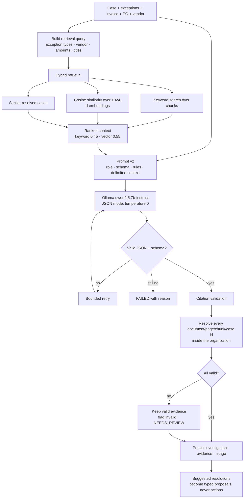

# AI architecture

## 1. Principle

RESOLVE uses AI where language understanding helps and deterministic code where correctness matters.
The model may read, summarise and recommend. It may not calculate a payable amount, change a state,
approve, execute or write to the database.

## 2. Model and runtime

| Component | Value |
| --- | --- |
| Runtime | Ollama on the Windows host, reached from containers via `host.docker.internal:11434` |
| Chat model | `qwen2.5:7b-instruct` |
| Embedding model | `bge-m3` |
| Embedding dimension | 1024 |
| Vector index | pgvector HNSW (`ix_document_chunks_embedding_vec`) |
| Provider abstraction | `ollama`, `openai`, `stub`, `none`; OpenAI-compatible base URL |
| Timeouts / retries | 60 s default, bounded retries with backoff |
| Cost accounting | input/output tokens and USD rates, persisted per run |

No hosted API key is required, and no document text leaves the machine in this configuration.

## 3. Investigation pipeline

## 4. Output contract

The model returns one JSON object with:

- `summary` — what happened, in operational language;
- `root_cause` and `root_cause_hypotheses` with confidence;
- `evidence` — citations to document chunks, invoices, POs, cases or history;
- `missing_information` and `limitations`;
- `required_actions`;
- `suggested_resolutions` — an action key and parameters drawn from the allow-list;
- `risk_level` and `requires_human_review`.

Invalid JSON is retried, then the run fails honestly. A suggestion is never executed by the AI; it is
turned into a proposal that follows the normal policy and approval path.

## 5. Grounding and validation

Every citation is resolved against the database with an organization filter:

1. document/page/chunk ids must exist in the same org;
2. the quoted text must be compatible with the stored chunk;
3. the cited invoice/PO/case must belong to the same org;
4. invalid citations are stored with `is_validated=false` and reduce confidence;
5. if too few citations validate, the investigation is marked for human review.

In the verified run, the investigation produced 3 validated evidence items (invoice, contract chunk,
historical case) out of 3, with 85% heuristic confidence and a 12.4 s latency.

## 6. Retrieval design

- Chunks are ~900 characters with 120 overlap, generated per document page group.
- Embeddings are stored in `document_chunks.embedding_vec` and indexed with HNSW.
- Search is hybrid: normalized keyword score and cosine similarity, weighted and filtered by
  permission/status and organization.
- Retrieval is bounded (`top_k` default 6) and the prompt includes only the selected chunks.
- Similar resolved cases are retrieved by exception type, vendor and outcome, giving the model
  institutional memory without leaking other tenants.

## 7. Prompt-injection and safety

- Document text is treated as data inside delimiters, never as instructions.
- The system prompt forbids inventing ids, quotes or amounts and requires the schema.
- The model has no tools, no database credentials and no network access beyond the provider call.
- Output is validated against the schema before anything is persisted.
- Money math is recomputed by deterministic code; model-provided arithmetic is never trusted.
- AI runs store provider, model, prompt version and usage for audit.

## 8. Failure behaviour

| Failure | Behaviour |
| --- | --- |
| Provider unreachable | investigation FAILED with a clear error; case remains usable |
| Timeout / rate limit | bounded retry with backoff, then fail |
| Invalid JSON | retry once, then fail with `ai_invalid_output` |
| Invalid citations | evidence flagged, run marked for review |
| Insufficient evidence | `NEEDS_REVIEW`, no fabricated certainty |
| Embedding provider down | indexing degrades gracefully; deterministic retrieval still works |

## 9. Evaluation

An evaluation module can run datasets through the real provider and compute accuracy, precision,
recall, F1, root-cause accuracy, evidence validity, citation quality, recommendation quality and
groundedness. The deterministic stub provider is labelled explicitly so test results cannot be
mistaken for model quality.

## 10. Why not let the model approve?

Because approval is a financial control with legal and audit consequences. The model can be wrong,
manipulated by document text, or confidently incoherent. Keeping approval deterministic and human
makes the system defensible: a person with the right role made a recorded decision based on evidence
they could inspect.
