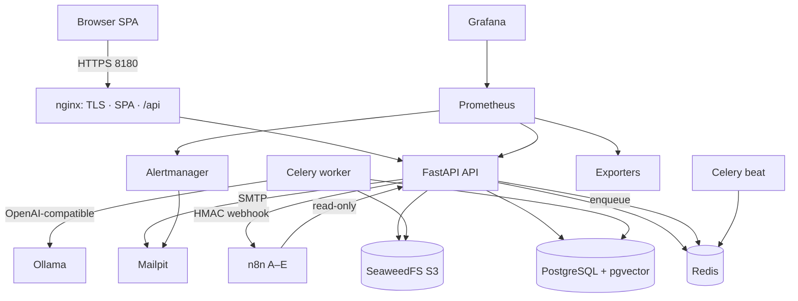
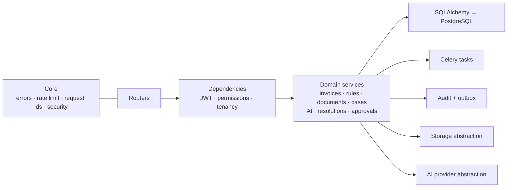
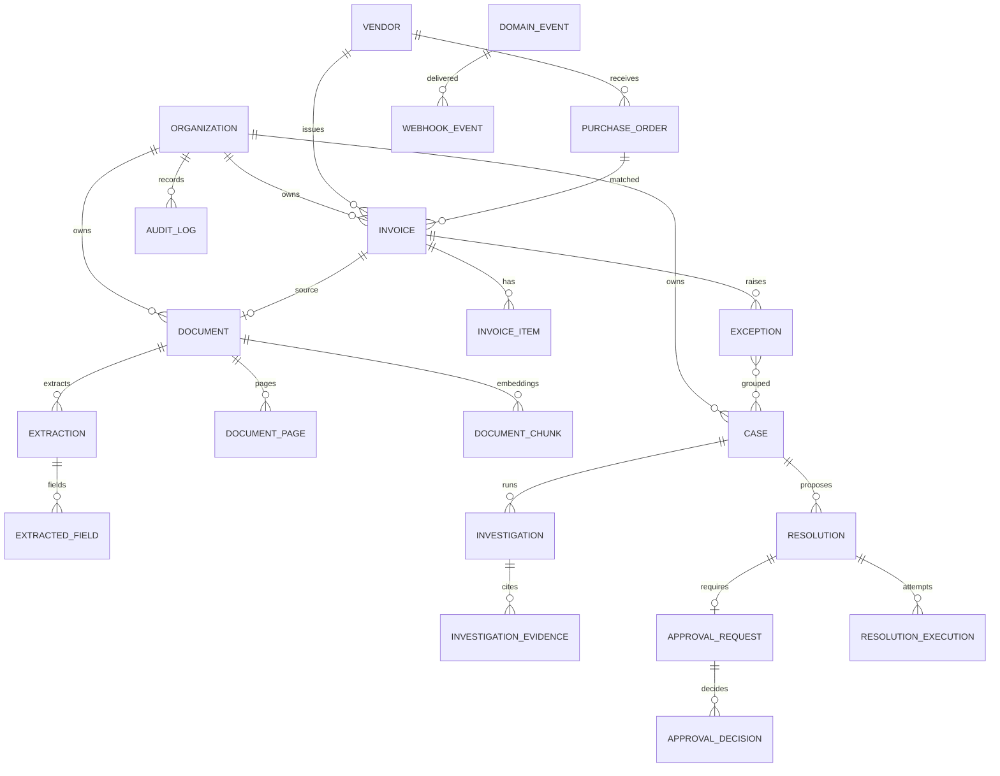
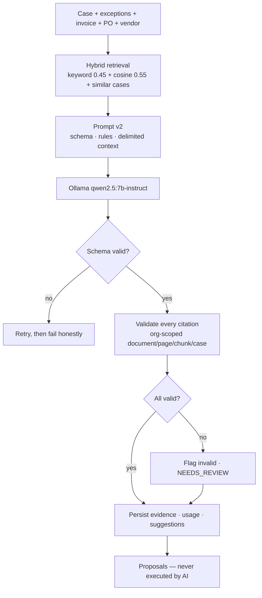
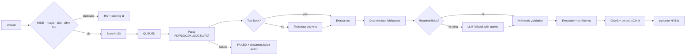
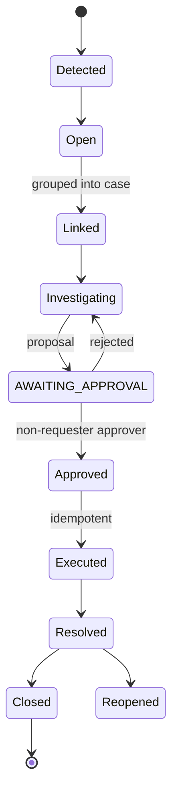
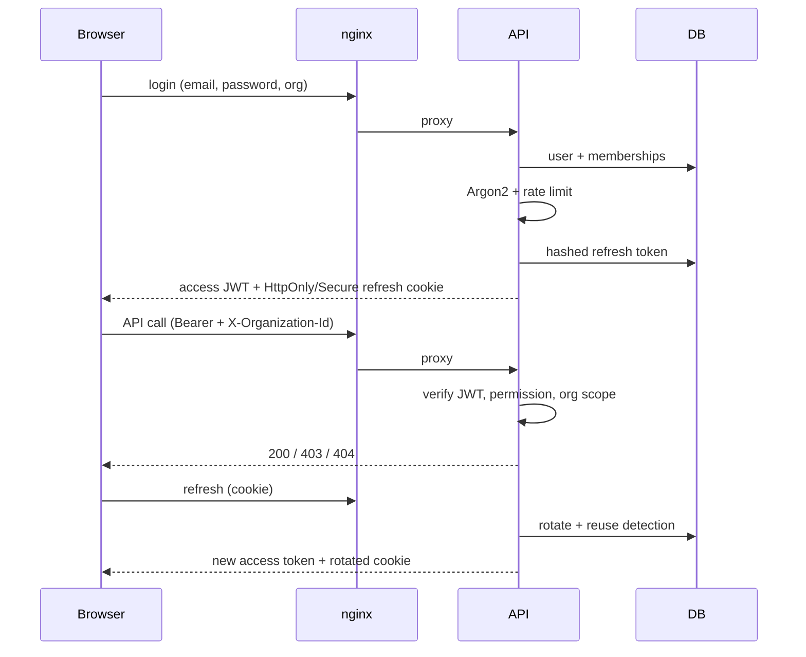
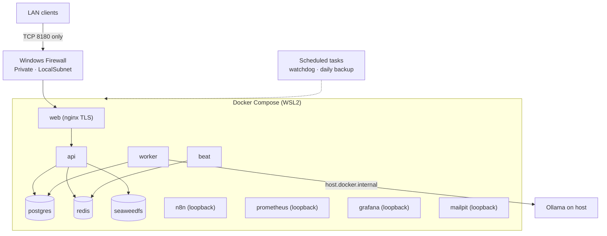
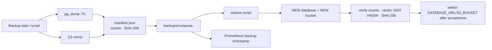

# Architecture diagrams

All diagrams use Mermaid and render on GitHub/GitLab. They reflect the implementation, not an
aspirational design.

## 1. High-level system architecture

## 2. Backend architecture

## 3. Database relationships

## 4. AI investigation pipeline

## 5. Document processing pipeline

## 6. Exception resolution workflow

## 7. Authentication and authorization

## 8. Deployment architecture

## 9. Backup and restore

