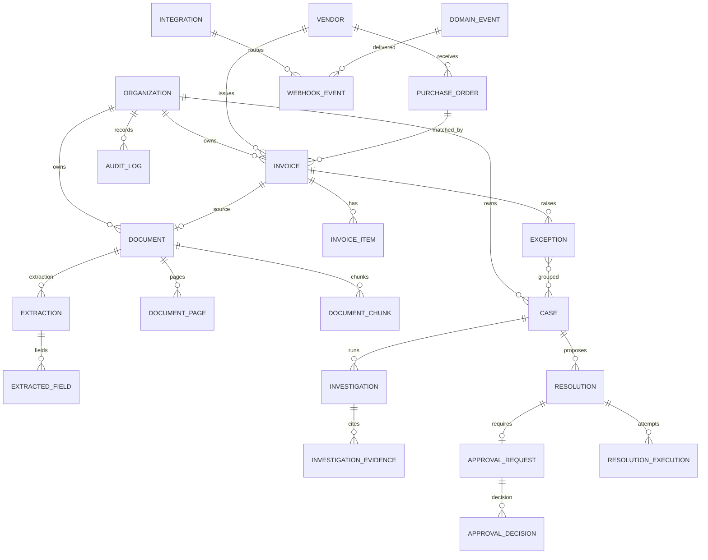

# Database design

PostgreSQL 16.16 with pgvector 0.8.7. 50 tables in the public schema. The schema is created and
changed only through Alembic migrations; production does not auto-create tables.

## 1. Entity groups

| Group | Tables (examples) | Purpose |
| --- | --- | --- |
| Identity | `organizations`, `users`, `roles`, `permissions`, `role_permissions`, `memberships`, `refresh_tokens`, `password_reset_tokens` | tenancy, auth, RBAC |
| Vendor / PO | `vendors`, `purchase_orders`, `po_items` | master data and commitments |
| Invoices | `invoices`, `invoice_items`, `validation_checks` | financial documents and checks |
| Exceptions | `exception_rules`, `exception_rule_versions`, `exceptions` | detection and triage |
| Cases | `cases`, `case_activities`, `case_comments`, `case_links` | investigation workspace |
| Documents | `documents`, `document_pages`, `document_versions`, `extractions`, `extracted_fields`, `document_chunks` | ingestion and intelligence |
| AI | `investigations`, `investigation_evidence`, `investigation_suggestions`, `ai_providers`, `ai_prompts`, `ai_runs` | grounded investigation and usage |
| Resolutions | `resolutions`, `resolution_executions`, `approval_requests`, `approval_decisions` | human-in-the-loop action |
| Notifications | `notifications`, `notification_preferences` | in-app/email delivery |
| Automation | `integrations`, `integration_credentials`, `webhook_events`, `workflow_executions`, `background_jobs` | outbox and n8n |
| Governance | `audit_logs`, `domain_events`, `saved_filters` | audit and outbox |
| Evaluation | `evaluation_datasets`, `evaluation_samples`, `evaluation_runs`, `evaluation_results` | AI quality |

## 2. Core relationships

## 3. Tenancy

- Almost every business table has `org_id` with a foreign key to `organizations` and an index that
  starts with `org_id`.
- Unique constraints are tenant-scoped, e.g. `unique(org_id, case_number)`,
  `unique(org_id, vendor_number)`, `unique(document_id, chunk_index)`.
- Services always filter by `org_id` from the authenticated principal; a foreign id returns 404.
- Cross-tenant access is part of the acceptance suite (verified 404 for a case, vendor and document).

## 4. Money and precision

- Money columns are `NUMERIC(18,4)`; quantities `NUMERIC(16,4)`; tax rates `NUMERIC(9,4)`.
- Python uses `Decimal`, never `float`, for financial calculations.
- Line totals are computed server-side: `quantity * unit_price`, quantized; invoice totals compared
  against line sums and subtotal + tax with a cent-level tolerance.
- Validated arithmetic is persisted as checks and shown in the UI; a failing check blocks clean
  approval paths and feeds the exception engine.

## 5. Documents and vectors

- `document_chunks.content` stores the chunk text; `embedding` (JSON) is the portable representation;
  `embedding_vec vector(1024)` is the searchable column.
- HNSW index: `ix_document_chunks_embedding_vec` using `vector_cosine_ops`.
- Verified on the restored database: 16–20 rows, `vector_dims = 1024`, nearest-neighbour query
  returns results without a sequential fallback error.
- Documents are immutable per version; `document_versions` keeps storage keys and SHA-256 hashes.
- Soft delete (`deleted_at`) is used where business history matters; queries exclude deleted rows.

## 6. Audit and outbox

- `audit_logs` stores action, entity type/id, actor, request id, before/after JSON and timestamp. It is
  append-only by policy and is never updated by the application.
- `domain_events` is a transactional outbox: `status` (`PENDING/PUBLISHED/FAILED/SKIPPED`), attempts,
  last error, payload. The beat task publishes every minute with HMAC-signed HTTP.
- `webhook_events` records both inbound and outbound deliveries with response status, error and an
  idempotency key unique per organization.

## 7. Keys, indexes and constraints

- UUID primary keys generated application-side for portability.
- Unique constraints encode business identity (invoice number per vendor, case number per org, PO
  number per org, document chunk index per document).
- Common query paths have composite indexes: `(org_id, status)`, `(org_id, priority)`,
  `(assigned_user_id, status)`, `(org_id, due_at)`, `(org_id, document_id)`, `(org_id, created_at)`.
- Foreign keys use explicit `ON DELETE` behaviour (cascade for dependent children, `SET NULL` for
  actor references) so history is preserved when a user leaves.

## 8. Concurrency and idempotency

- Approval decisions use a conditional `UPDATE ... WHERE status='PENDING'` and require `rowcount = 1`.
- Resolution execution is guarded by an idempotency key and an execution record per attempt.
- Document ingestion deduplicates by SHA-256 and returns 409 with the existing document id.
- Inbound webhooks deduplicate by `Idempotency-Key` per organization.
- Celery tasks are written to be safe on retry; a claimed document that is already processed skips.
- n8n consumers claim an event id through the API (`SET NX EX` in Redis) before acting.

## 9. Migrations

- Alembic head is `f7b2c9d4a1e3` in this release; the container runs `alembic upgrade head` on start.
- A real migration drift (a stamped revision whose column was missing) was found and repaired with a
  downgrade/re-upgrade; data was preserved and verified.
- Production disables `AUTO_CREATE_SCHEMA`, so a missing migration fails loudly instead of silently
  creating a partial schema.

## 10. Backup and restore implications

- Backups are PostgreSQL custom-format dumps plus an S3 mirror; `manifest.json` records row counts and
  the dump SHA-256.
- Restores go to a new database and bucket. Verification checks row counts, `alembic_version`,
  pgvector dimension, HNSW presence, a nearest-neighbour query and an object SHA-256.
- Encryption keys (`SECRET_KEY` / `CREDENTIAL_ENCRYPTION_KEY`) must accompany a restore, or encrypted
  integration credentials become undecryptable.
