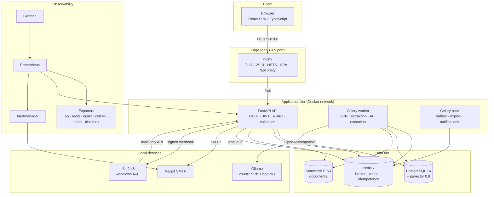
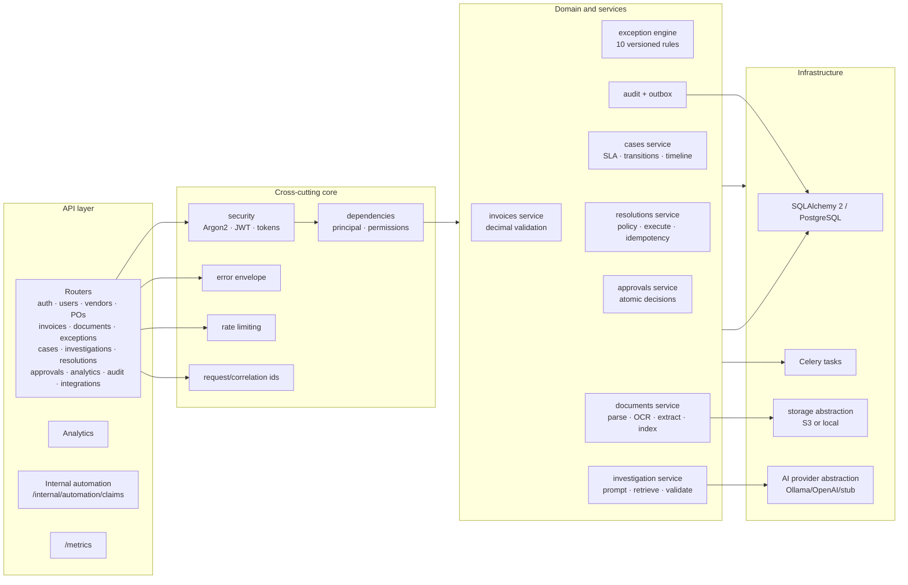
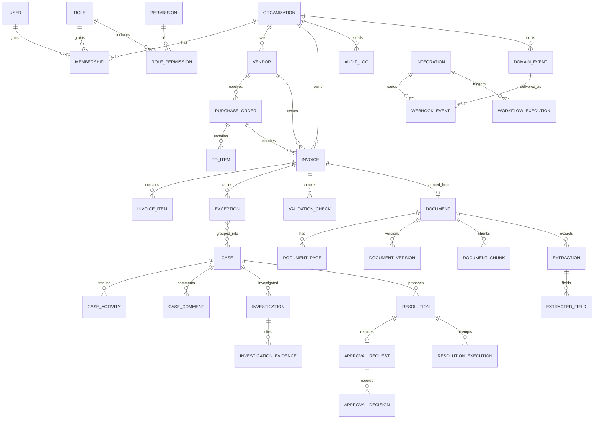
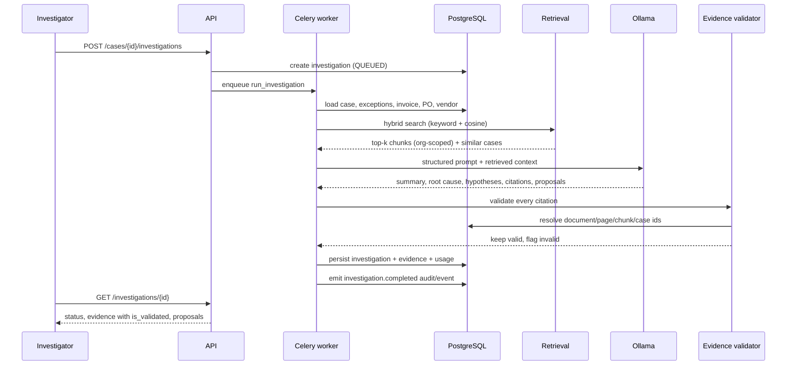
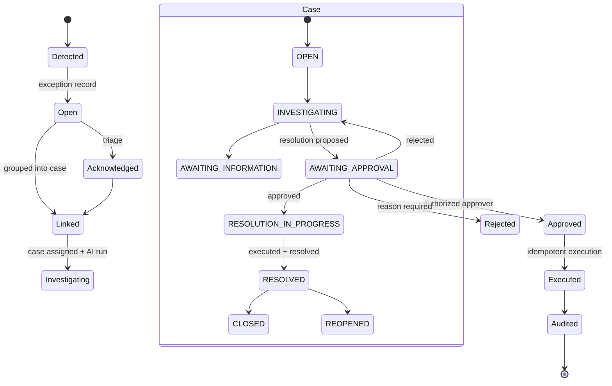
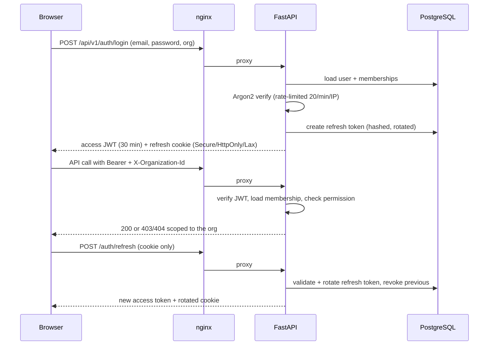
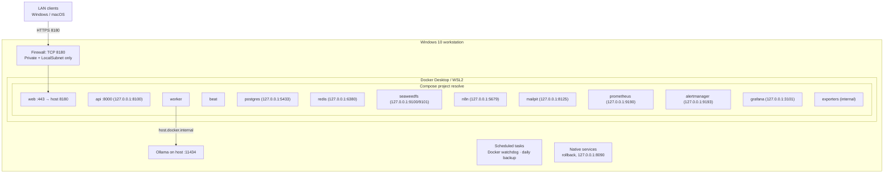
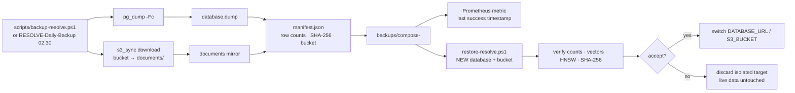

# Technical architecture

RESOLVE is a modular monolith on the backend, a single-page application on the frontend, and a small
set of background workers and integration services around them. The architecture is intentionally
boring where correctness matters (money, permissions, approvals) and deliberately careful where AI
touches the system.

## 1. High-level system architecture

Only nginx is reachable from the LAN. PostgreSQL, Redis, object storage, n8n, monitoring and Mailpit
are bound to loopback or exist only on the Docker network.

## 2. Backend architecture

Layering rules used in the codebase:

- Routers own HTTP concerns only; business logic lives in `modules/*/service.py`.
- Every query is scoped by `org_id`; permission checks are dependency-injected.
- Services return domain objects; Pydantic schemas shape the wire format.
- Background work is always enqueued after commit (transactional outbox pattern).
- Domain events are written in the same transaction as the business change and fanned out later, so a
  webhook failure never rolls back a financial decision.

## 3. Database relationships (core)

Money is stored as `NUMERIC(18,4)` and handled with `Decimal` in Python (quantized to cents at the
boundary). Embeddings are `vector(1024)` with an HNSW index. Audit rows and domain events are
append-only by policy.

## 4. AI investigation pipeline

Safety properties:

- The prompt includes only records the requester may read and of the same organization.
- The model returns a strict JSON schema; malformed output is retried then failed.
- Citations that do not resolve to real rows are marked invalid; they are never shown as proof.
- The model cannot call tools, execute actions or write to the database.
- Token, cost and latency are persisted for every run.

## 5. Document processing pipeline

```mermaid
flowchart LR
  A["Upload<br/>MIME + magic + size + SHA-256"] --> B{"Duplicate?"}
  B -->|yes| B1["409 duplicate_document<br/>return existing id"]
  B -->|no| C["Store bytes in S3<br/>key = org/uuid/version/file"]
  C --> D["Document row (QUEUED)"]
  D --> E["Celery process_document"]
  E --> F["Download + parse<br/>PDF/DOCX/XLSX/CSV/TXT"]
  F --> G{"Text layer?"}
  G -->|no| H["Render page → Tesseract<br/>eng+tha"]
  G -->|yes| I["Extract text"]
  H --> I
  I --> J["Deterministic invoice parser<br/>labels · dates · amounts · tax ids"]
  J --> K{"Required fields?"}
  K -->|missing| L["Optional LLM fallback<br/>quote-validated"]
  K -->|complete| M["Arithmetic validation"]
  L --> M
  M --> N["Extraction + fields + confidence"]
  N --> O["Chunk + embed (bge-m3, 1024-d)"]
  O --> P["pgvector HNSW + knowledge search"]
  N --> Q["requires_review if low confidence / missing / arithmetic issue"]
  F -->|failure| X["Document FAILED<br/>redacted error + document.failed event"]
```

A corrupt file fails safely and can be reprocessed later; the failure emits a domain event that n8n
turns into an operator notification.

## 6. Exception to resolution workflow

The requester cannot decide their own approval. Approval and execution are separate permissions.
A failed execution is persisted with its error and can be retried without duplicating the side effect.

## 7. Authentication and authorization flow

Refresh-token reuse is detected and revokes the session family. Logout revokes the session.
Password change signs out other sessions. Every request carries a correlation id used in logs and
error envelopes.

## 8. Deployment architecture

## 9. Backup and restore flow

Restores always go to a new database and bucket by default. The live database is never overwritten
during verification.

## 10. Architectural decisions worth defending

| Decision | Why |
| --- | --- |
| Modular monolith, not microservices | One team, one transaction boundary, simpler correctness for money and approvals |
| Postgres for relational + vectors | One operational dependency instead of two; HNSW is fast at this scale |
| Deterministic rules before AI | Auditable, cheap, and reproducible; AI only explains and recommends |
| Transactional outbox for events | Webhook/n8n failures cannot roll back financial changes |
| Separate approval object | Policy, expiry, assignment, self-approval and audit are first-class |
| Atomic claim for approvals | Prevents double decisions under concurrency (verified by test) |
| Loopback-only management plane | A single HTTPS entry point is a smaller attack surface |
| Local-first AI | No data leaves the machine; provider abstraction allows OpenAI-compatible endpoints |
